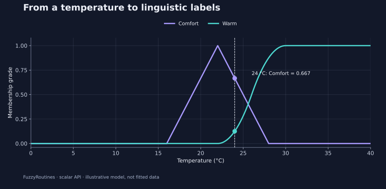

<!--
SPDX-FileCopyrightText: 2019-2026 Timur Gilmullin and Fuzzy Technologies
SPDX-License-Identifier: Apache-2.0
-->

<p align="center">
  
</p>

# FuzzyRoutines

Turn measurements into interpretable linguistic grades with explicit fuzzy mathematics.

Classify measurements, combine fuzzy criteria, inspect sets and explain results.
**CPython 3.13–3.14 · no mandatory runtime dependencies · Apache-2.0**

[Latest documentation](https://fuzzy-technologies.github.io/FuzzyRoutines/api/latest/en/) ·
[Русский](https://fuzzy-technologies.github.io/FuzzyRoutines/api/latest/ru/) ·
[简体中文](https://fuzzy-technologies.github.io/FuzzyRoutines/api/latest/zh-CN/)

## Try it: is 24 °C comfortable or warm?

Install [FuzzyRoutines 2.1.0 from PyPI](https://pypi.org/project/fuzzyroutines/2.1.0/)
to reproduce this example:

```console
python -m pip install fuzzyroutines==2.1.0
```

```python
from fuzzyroutines import (
    ContinuousUniverse, LinguisticScale, LinguisticTerm,
    ScalarFuzzySet, SShoulder, Triangle,
)

universe = ContinuousUniverse(0, 40, leftClosed=True, rightClosed=True)
scale = LinguisticScale((
    LinguisticTerm("Comfort", ScalarFuzzySet(universe, Triangle(16, 22, 28))),
    LinguisticTerm("Warm", ScalarFuzzySet(universe, SShoulder(22, 30))),
))
result = scale.Fuzzify(24)
print({item.term.name: round(item.grade, 3) for item in result.memberships})
print(result.selectedTerms[0].name)
```

```text
{'Comfort': 0.667, 'Warm': 0.125}
Comfort
```

These illustrative thresholds define the model. Membership grades describe how
well the measurement fits each concept; they are not probabilities and need not
sum to one. The two terms do not cover every temperature.



## Use with your AI assistant

Copy this request:

> Use FuzzyRoutines 2.1.0 and its modern Python API to classify a 24 °C
> measurement. Verify Python, install exactly 2.1.0 from PyPI, and check the
> installed package version. Run the example and check Comfort = 2/3, Warm = 0.125,
> selected label = Comfort. Return the code and observed values. Explain the
> chosen thresholds and distinguish membership grades from probabilities.
> If Python execution is unavailable, label the output as expected.

[Current quick start](https://fuzzy-technologies.github.io/FuzzyRoutines/api/latest/en/quick-start/) ·
[Current agent guide and capability map](https://fuzzy-technologies.github.io/FuzzyRoutines/api/latest/en/agent-quickstart/)

## Explore a useful scenario

These guides and the compatibility notes come from the `v2.1.0` tag.

| Goal                              | Start here                                                                                                                               |
| --------------------------------- | ---------------------------------------------------------------------------------------------------------------------------------------- |
| Classify a measurement            | [Temperature example](https://github.com/Fuzzy-Technologies/FuzzyRoutines/blob/v2.1.0/docs/site/content/en/guides/temperature.md)        |
| Choose membership curves          | [Membership gallery](https://github.com/Fuzzy-Technologies/FuzzyRoutines/blob/v2.1.0/docs/site/content/en/guides/membership-families.md) |
| Combine criteria, inspect results | [Worked examples](https://github.com/Fuzzy-Technologies/FuzzyRoutines/blob/v2.1.0/docs/site/content/en/guides/index.md)                  |
| Maintain existing 1.x software    | [Compatibility and migration](https://github.com/Fuzzy-Technologies/FuzzyRoutines/blob/v2.1.0/docs/COMPATIBILITY.md)                     |

## Explore 2.1 features

FuzzyRoutines 2.1 adds the historical Universal Fuzzy Scale factory,
linguistic encodings, traced Mamdani and Sugeno inference, explicit NumPy
batches and optional CPU neural examples. The scalar core keeps zero mandatory
runtime dependencies.

See the [2.1.0 release notes](https://github.com/Fuzzy-Technologies/FuzzyRoutines/releases/tag/v2.1.0)
and the [documentation sources tagged `v2.1.0`](https://github.com/Fuzzy-Technologies/FuzzyRoutines/tree/v2.1.0/docs/site/content)
for material tied to this release.

## Learn more

- [Latest API reference](https://fuzzy-technologies.github.io/FuzzyRoutines/api/latest/en/api/)
- [2.1.0 mathematical contracts](https://github.com/Fuzzy-Technologies/FuzzyRoutines/blob/v2.1.0/docs/MATHEMATICAL_MODEL.md)
- [2.1.0 benchmarks and their limits](https://github.com/Fuzzy-Technologies/FuzzyRoutines/blob/v2.1.0/docs/performance/installed-batch-results.md)
- [Changelog at `v2.1.0`](https://github.com/Fuzzy-Technologies/FuzzyRoutines/blob/v2.1.0/CHANGELOG.md)

The hosted `/latest/` reference follows the approved default branch and can
change. Use the [documentation version guide](https://fuzzy-technologies.github.io/FuzzyRoutines/api/versions/)
and match the source tag to the installed version when reproducing a result.

## Contribute

For work on the development branch, follow the
[development and evidence rules](https://github.com/Fuzzy-Technologies/FuzzyRoutines/blob/develop/docs/development-evidence-protocol.md).

## License

[Apache-2.0](https://github.com/Fuzzy-Technologies/FuzzyRoutines/blob/v2.1.0/LICENSE). Preserve the license and [NOTICE](https://github.com/Fuzzy-Technologies/FuzzyRoutines/blob/v2.1.0/NOTICE).
