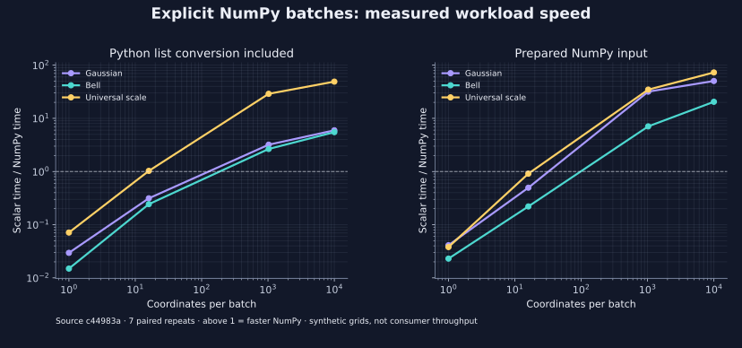
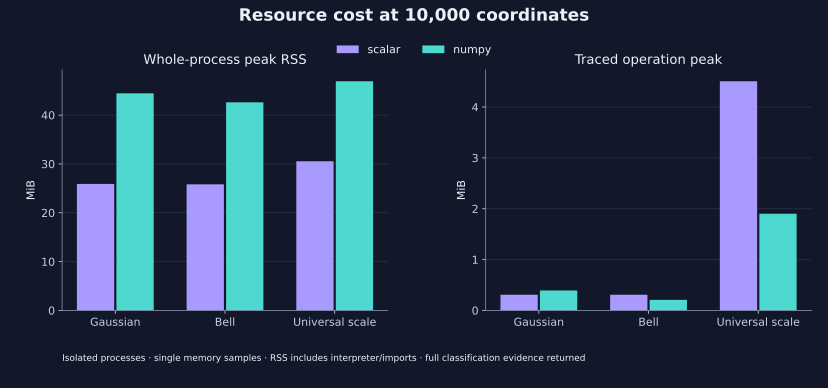

<!--
SPDX-FileCopyrightText: 2026 Timur Gilmullin and Fuzzy Technologies
SPDX-License-Identifier: Apache-2.0
-->

# Installed 2.1.0 NumPy candidate results

Historical measurements from 14 October. See the [post-audit installed
results](post-audit-installed.md) for the corrected implementation and fresh
16 October artifact identities; the raw observations below are retained.

The exact **2.1.0 CI wheel** was measured on 14 October 2026. Both the scalar
reference and NumPy operations came from that installed wheel. This is additive
release-candidate evidence; the earlier [synthetic source study](public-batch-comparison.md)
and [public consumer source replay](public-consumer-batch-replay.md), their raw
records and their figures remain unchanged. Timing is observational, never a CI
acceptance threshold.

## Artifact identity

- Package source commit: [`c44983ab4be2ef58d7847e758c118875a51738db`](https://github.com/Fuzzy-Technologies/FuzzyRoutines/commit/c44983ab4be2ef58d7847e758c118875a51738db).
- Successful [package CI run](https://github.com/Fuzzy-Technologies/FuzzyRoutines/actions/runs/38627553915); measured wheel `fuzzyroutines-2.1.0-py3-none-any.whl`, SHA-256 `de07010468aceea6059225f867e44c80bd89ed64984826aad9e85b4b8723a7e0`.
- Separately published, clean harness commit: [`b451e502930d581fdffdc2a69ac44a8f3ab18174`](https://github.com/Fuzzy-Technologies/FuzzyRoutines/commit/b451e502930d581fdffdc2a69ac44a8f3ab18174).
- [Synthetic raw JSON](evidence/public-batches-installed-python314.json), SHA-256 `c30dae66247bde7db4993b8ad5a54629ba2d5b790fa75e2197d60652ad5e4f96`.
- [Consumer-replay raw JSON](evidence/public-consumer-replays-installed-python314.json), SHA-256 `daf317b332b46ef4009e48943ae0124888d3bb6658b01abe280daeba00b7efdc`.

The verifier matched the wheel's static name/version and every package
`.py`/`py.typed` file to the declared Git source, then checked the installed
copies and import origins. All evaluation, memory and import workers used the
isolated installed interpreter; the source core was never added to its import
path. The raw records separate the package identity, installed locations and
harness hashes. A later wheel with different archive bytes is a different
artifact even if a separate payload comparison establishes identical code.

CPython 3.14.8, NumPy 2.3.5, Linux x86-64 and an Intel Xeon Platinum 8573C were
used. Full interpreter, CPU, affinity, cgroup, thread and installation details
are in JSON. Our other benchmarks were stopped for this run; the host remained
shared, without a claim of exclusive hardware or stable application throughput.

## Synthetic batch results

There are 24 combinations: three public workloads, four shapes `(1,)`, `(16,)`,
`(32, 32)`, `(10000,)`, and two input modes. Each has one warmup and seven paired
repeats with alternating backend order. Ratios below are the scalar median wall
time divided by the NumPy median wall time; values below one mean NumPy was
slower. Raw wall/CPU samples, minima, maxima and inclusive IQR are retained.

| Workload        | Coordinates | List conversion | Prepared array |
| --------------- | ----------: | --------------: | -------------: |
| Gaussian        |           1 |           0.03× |          0.04× |
| Gaussian        |          16 |           0.31× |          0.50× |
| Gaussian        |       1,024 |           3.20× |         31.82× |
| Gaussian        |      10,000 |           5.96× |         50.45× |
| Bell            |           1 |           0.01× |          0.02× |
| Bell            |          16 |           0.24× |          0.22× |
| Bell            |       1,024 |           2.66× |          7.06× |
| Bell            |      10,000 |           5.51× |         20.50× |
| Universal scale |           1 |           0.07× |          0.04× |
| Universal scale |          16 |           1.03× |          0.91× |
| Universal scale |       1,024 |          28.95× |         34.71× |
| Universal scale |      10,000 |          49.07× |         72.99× |



At one coordinate NumPy was slower in every workload. The individual functions
also remained slower at 16 coordinates, while scale classification was near
parity. At 10,000 coordinates the list-input ratios were 5.96× for Gaussian,
5.51× for Bell and 49.07× for full scale classification; the corresponding
prepared-array ratios were 50.45×, 20.50× and 72.99×. Prepared arrays and lists
are different workloads and their figures must not be interchanged. The scalar
path consumes a flat list in both modes; variation between its recorded times
reflects separate samples, not a different scalar algorithm. This sparse grid
and shared-host variability establish no universal switching threshold.

All 24 grade checks passed with absolute tolerance `1e-12`, relative tolerance
zero; maximum observed error was `1.1102230246251565e-16`. Universal-scale
selected and tied masks matched exactly. Models were constructed before timing;
conversion where applicable, validation, result allocation and ownership
semantics remained inside the public call. Both scale paths return complete
membership and decision evidence.

## Public consumer test replays

The [pinned TKSBrokerAPI fixture](../../tests/fixtures/public_consumer_batches.json)
contains the original ordered 17 `RiskLong` and 13 `RiskShort` test inputs. Each
original consumer call classifies one coordinate; these groups combine public
test cases to exercise batch shapes. They are not observed production batches.
Price normalization, model construction, the consumer engine and network
access are outside the measured operation. Source attribution, normalization
and independent expected labels/percentages are documented in the
[fixture study](public-consumer-batch-replay.md#source-and-extraction).

| Public replay | Coordinates | Input           | Scalar median (IQR), ms | NumPy median (IQR), ms | Scalar / NumPy |
| ------------- | ----------: | --------------- | ----------------------: | ---------------------: | -------------: |
| RiskLong      |          17 | Prepared array  |           1.137 (0.412) |          1.212 (0.374) |          0.94× |
| RiskLong      |          17 | List conversion |           1.328 (0.201) |          1.316 (0.338) |          1.01× |
| RiskShort     |          13 | Prepared array  |           0.844 (0.086) |          1.044 (0.547) |          0.81× |
| RiskShort     |          13 | List conversion |           0.983 (0.174) |          1.612 (0.411) |          0.61× |

All four combinations passed: grade error was zero, selected/tied masks matched,
and all 30 independently authored labels and percentages rounded to four
places matched. Ratios ranged from 0.61× to 1.01×, with no consistent NumPy
advantage for these small replay groups. The IQR is the spread of seven samples,
not a confidence interval. Keep scalar execution for such small calls unless
measurement of the actual caller supports grouping them. These results do not
establish FMA/robot performance, trading behavior or application throughput.

## Memory and optional dependency costs

Single-process observations at 10,000 list coordinates were:

| Workload        | Scalar RSS, MiB | NumPy RSS, MiB | Scalar traced, MiB | NumPy traced, MiB |
| --------------- | --------------: | -------------: | -----------------: | ----------------: |
| Gaussian        |           25.90 |          44.46 |               0.31 |              0.39 |
| Bell            |           25.83 |          42.62 |               0.31 |              0.21 |
| Universal scale |           30.55 |          46.93 |               4.51 |              1.90 |



RSS includes interpreter, verification harness and imports; it is not an
incremental array cost or a portable memory requirement. Traced allocations
were measured in a separate call from untraced time and RSS observations.
Dense scale arrays used a smaller traced operation peak than scalar result
objects, while whole-process NumPy RSS remained higher. Consumer replay
observations and array payload sizes are retained in their raw record.

Median fresh-process import time was 66.27 ms for the scalar package and
171.21 ms for NumPy. Process startup and verification were excluded from
these timers; verification read package bytes beforehand and filesystem caches
were not flushed. The pinned NumPy wheel occupied
15.83 MiB; installed RECORD-listed files occupied
54.84 MiB in this `--no-compile` environment. Seven offline installs into
fresh environments had a median of 4.046 s, excluding environment creation,
download and bytecode compilation. Dependency-cost samples are retained in the synthetic record; the consumer
record links that exact record by SHA-256.

## Reproduce

Follow the [installed-candidate protocol](installed-batch-benchmark.md) with the
identities above and locally downloaded wheels. The runner refuses a dirty or
incorrect harness revision, mismatched artifacts and an existing output
directory. It retains the original paired timers and mathematical operations;
only source-oriented worker dispatch and provenance are adapted for installation.

The additive figures use the existing generator and a separate directory:

```bash
python -m tools.generate_batch_figures --evidence docs/performance/evidence/public-batches-installed-python314.json --output-directory docs/site/content/en/assets/figures/installed-candidate --check
```

The graph source identifier is the verified package commit. The SVG metadata
names the installed-candidate JSON; old source figures retain their original
bytes. Performance comparisons concern these exact workloads and this measured
artifact, while supported Python/NumPy parity and dependency-isolation matrices
remain separate CI evidence.
