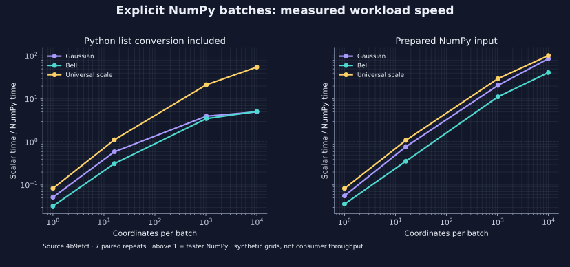
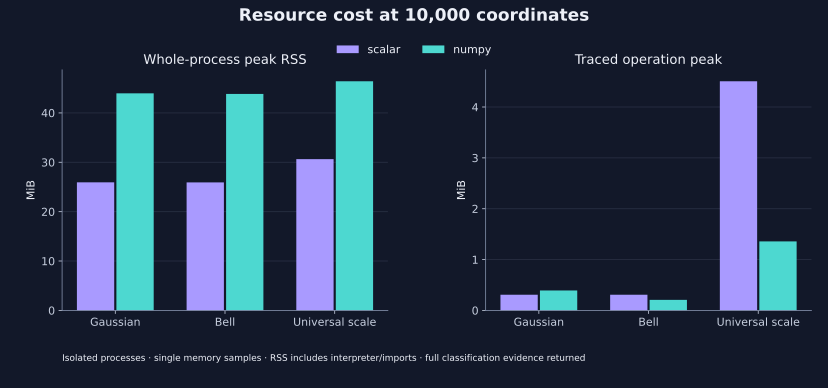

<!--
SPDX-FileCopyrightText: 2026 Timur Gilmullin and Fuzzy Technologies
SPDX-License-Identifier: Apache-2.0
-->

# Post-audit installed evidence — 2026-10-16

The corrected scalar and batch implementation was measured from the successful
[CI package run 38903501182](https://github.com/Fuzzy-Technologies/FuzzyRoutines/actions/runs/38903501182).
This supersedes the 14 October timings for release acceptance; earlier reports
remain historical. The [acceptance manifest](evidence/post-audit-installed/acceptance.json)
binds artifacts and raw reports. No timing threshold or universal speedup is claimed.

- Workflow head and clean public harness: `bd6f0af22be325967c2694c9497e50b0af2cbff7`.
- Built synthetic merge: `4b9efcf67f42aee15bbce3aeac7bbb55388a4822`.
- Wheel SHA-256: `cf694da86b560d3619a5480f67a943ca7eb87a90e1c9fde97e188b380e86b883`.
- Sdist SHA-256: `a2d3aff466073c9e93123d80fbe85df5d522a2b2d7465f1c9f58c0f1b2c547cd`.
- Both supported-interpreter CI archives contain byte-identical wheel/sdist files.
- CPython 3.14.8, NumPy 2.3.5, Linux x86-64, AMD EPYC 9V74; host limits,
  interpreter hashes, installed origins and exact dependency inventories are in JSON.

The unchanged [scalar protocol](installed-scalar-comparison-protocol.md) and
[batch protocol](installed-batch-benchmark.md) verified actual CI archive/run
identity, source bytes and installed copies before measurements. Isolated
workers did not import checkout package code. Seven alternating pairs, declared
warmups, wall/CPU raw samples, minima/medians/IQR, independent numerical checks
and separately traced memory/import observations were retained. The scalar and
batch studies ran sequentially; the host was shared.

## Scalar correctness and cost

The [30-case comparison](post-audit-scalar.md) against installed PyPI 2.0.0 passed
all independent scalar and closed-form centroid checks. Its
[raw record](evidence/post-audit-installed/scalar.json) retains mixed results.
The generic historical hyperbolic centroid took 5.2613 ms versus 1.2570 ms for
2.0.0 (about 4.19 times slower). The stricter global moment/error algorithm,
queue and validation differ from the baseline's per-panel refinement. This is
a material cost on that workload, not evidence of equal global accuracy or a
universal scalar slowdown. Analytical polynomial paths remain in microseconds.

An [intermediate profile](evidence/post-audit-installed/initial-quadrature-profile.json)
identified 24.6531 ms with repeated full-partition scans. Cached replacement
sums removed that quadratic work; a complete compensated sum is still required
before accepting the global estimated-error budget. The final installed result
above is about 4.69 times faster than that intermediate implementation.

## Public NumPy calls

The [raw batch study](evidence/post-audit-installed/batches.json) contains all
24 workload/shape/input-mode combinations. These ratios are scalar median wall
time divided by NumPy median wall time from the same installed wheel:

| Workload        | Values | List conversion | Prepared array |
| --------------- | ------ | --------------- | -------------- |
| gaussian        | 1      | 0.05×           | 0.06×          |
| gaussian        | 16     | 0.59×           | 0.78×          |
| gaussian        | 1024   | 3.98×           | 20.74×         |
| gaussian        | 10000  | 5.02×           | 86.58×         |
| bell            | 1      | 0.03×           | 0.04×          |
| bell            | 16     | 0.31×           | 0.36×          |
| bell            | 1024   | 3.50×           | 11.25×         |
| bell            | 10000  | 5.13×           | 41.24×         |
| universal_scale | 1      | 0.08×           | 0.08×          |
| universal_scale | 16     | 1.12×           | 1.10×          |
| universal_scale | 1024   | 21.47×          | 29.75×         |
| universal_scale | 10000  | 55.08×          | 101.98×        |

All grade checks passed with absolute tolerance `1e-12`, relative zero; maximum
observed error was `1.1102230246251565e-16`. Classification masks matched exactly.
The [replay report](evidence/post-audit-installed/consumer-replays.json) passed
all 30 pinned public upstream test inputs in four groups, including exact labels
and four-decimal percentages. These synthetic test replays are not private
application throughput. Private FMA/robot integration remains unverified.

Conversion, validation, allocation and full result ownership stay inside public
calls. Large synthetic arrays benefit; small arrays can be slower. RSS includes
interpreter/imports and uses isolated processes; traced peaks are separate
observations. Neither this sparse size grid nor single memory observations define
a universal switching point or memory guarantee. The separate
[full-call before/after selection audit](batch-selection-audit.md) isolates the
first/last scan optimization and retains its small-call overhead finding.
