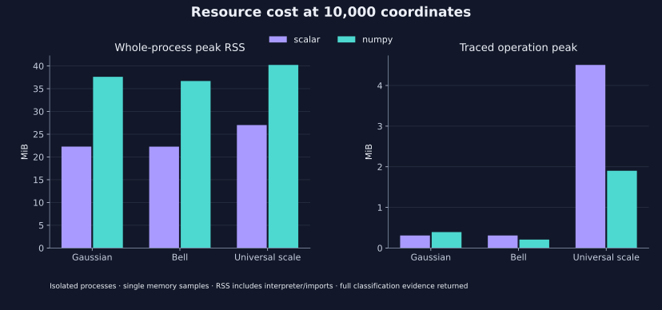

<!--
SPDX-FileCopyrightText: 2026 Timur Gilmullin and Fuzzy Technologies
SPDX-License-Identifier: Apache-2.0
-->

# Public NumPy batch candidate comparison

This is a **source-candidate measurement**, not a benchmark of a published 2.1
wheel. Candidate and scalar reference use the same immutable mathematical
models and the same recorded revision. The public array path is separate from
the older repository-only prototype. Numerical parity is a release gate;
measured speed is observational and never a CI threshold.

## Reproduce

```bash
python -m pip install numpy==2.3.5
python -m pip download --no-deps --only-binary=:all: numpy==2.3.5 --dest /tmp/fr-numpy-wheel
python -m experiments.benchmark_public_batches --shapes 1 16 32x32 10000 --numpy-wheel /tmp/fr-numpy-wheel/<platform-wheel>.whl --output /tmp/public-batches.json
python -m pip install -r docs/requirements-plots.txt
python -m tools.generate_batch_figures --check
```

The figure check compares the committed SVG files with the committed raw record.
To plot a new run separately, use `python -m tools.generate_batch_figures --evidence /tmp/public-batches.json --output-directory /tmp/fr-batch-figures`.

Use the actual platform wheel filename reported by `pip download`. The default
benchmark also permits 100,000 coordinates; this run deliberately bounded
expensive scalar classification and traced allocation at 10,000. Each operation
has one warmup and seven paired samples with alternating backend order. Wall and
process-CPU samples, medians, minima and interquartile ranges are retained in the
[raw JSON](evidence/public-batches-python314-linux.json).

Inputs are deterministic inclusive [0,1] grids of shape `(1,)`, `(16,)`,
`(32, 32)` and `(10000,)`. The matrix shape demonstrates batch-axis preservation;
it is not a measured FMA/robot workload. Models are constructed before timing.
Scalar evaluation consumes a flat Python list in both modes. NumPy receives
that representation, nested for the matrix case, or a prepared float64 array.
Array conversion/copy, validation and output allocation remain inside each call.
Scale workloads return all grades and complete selection evidence on both paths;
they do not compare a labels-only kernel with full scalar result records.

## Source and environment

- Candidate and same-revision scalar baseline: `10b505d606059df085cb2c03ea85388f85fd6b39`.
- CPython 3.14.8, Linux x86-64, Intel Xeon Platinum 8573C, NumPy 2.3.5.
- Shared execution host; no exclusive CPU or application-throughput claim. Exact affinity, quotas, thread environment and package versions are in JSON.
- The checkout is recorded as dirty because documentation and evidence files were uncommitted. Every listed kernel and workload hash was independently verified against the named commit. The JSON preserves this state rather than claiming a clean tree.
- Raw JSON SHA-256: `d8640ffd29f4a5c61ef4833e7633f09a86bc3dfe6b4e64663c3346213cca02d4`.
- All 24 parity comparisons passed at absolute 1e-12, relative zero. Maximum observed grade error was `1.1102230246251565e-16`; Universal Fuzzy Scale selected and tied masks matched exactly.

## Time

Numbers below are scalar median time divided by NumPy median time. Below 1 means
NumPy was slower. These sparse measurements do not locate a universal crossover.

| Workload        | Coordinates | List input | Prepared array |
| --------------- | ----------: | ---------: | -------------: |
| Gaussian        | 1           | 0.04×      | 0.04×          |
| Gaussian        | 16          | 0.60×      | 0.54×          |
| Gaussian        | 1,024       | 3.87×      | 20.09×         |
| Gaussian        | 10,000      | 4.68×      | 82.30×         |
| Bell            | 1           | 0.04×      | 0.02×          |
| Bell            | 16          | 0.24×      | 0.42×          |
| Bell            | 1,024       | 1.80×      | 10.10×         |
| Bell            | 10,000      | 4.89×      | 38.98×         |
| Universal scale | 1           | 0.07×      | 0.07×          |
| Universal scale | 16          | 0.91×      | 1.05×          |
| Universal scale | 1,024       | 23.00×     | 26.01×         |
| Universal scale | 10,000      | 64.25×     | 66.34×         |


At one coordinate, the optional path was substantially slower. At 16 coordinates,
individual-family batches remained slower and scale classification was close to
parity. At 10,000 coordinates the observed list-input gains were 4.68× for Gaussian,
4.89× for Bell, and 64.25× for the full five-level scale result. Prepared-array gains
are a different workload and must not be quoted as list-input gains. Samples
come from a shared host; their spread is preserved in the raw record. This one
run cannot establish a stable switching threshold.

## Memory and dependency cost



Fresh memory workers measure whole-process RSS before tracing, then measure a
separate traced call. These are single observations, not distributions. At 10,000
list coordinates, Gaussian/Bell scalar RSS was approximately 22.3 MiB and NumPy
36.7–37.6 MiB; full scale classification used about 27.0 MiB scalar and 40.2 MiB
NumPy. The latter's traced operation peak was smaller than scalar because dense
arrays replace many Python result objects. RSS includes interpreter and imports;
it is neither incremental array allocation nor a portable memory requirement.

NumPy's median fresh-process import was 165.98 ms; the scalar package import was 42.38 ms. Process startup is excluded. The cached wheel occupied 15.83 MiB, and installed RECORD-listed files occupied 66.13 MiB. Median cached-wheel installation into a fresh environment was 4.26 s across seven runs, excluding environment creation, network download and bytecode compilation. Filesystem caches were not flushed.

## Scope and remaining release evidence

Use scalar calls for small workloads unless measurements of the actual caller
show otherwise. Use explicitly selected NumPy for sufficiently large eligible
batches when its dependency and memory costs fit the application. There is no
automatic dispatch or silent fallback. Preserve the caller's coordinate
normalization and decision policy; membership grades are not probabilities.

The optional backend's deterministic parity, ownership, invalid-input and
missing-dependency tests accompany this report. Supported Python/NumPy matrix
runs and isolated installed-wheel tests belong to the PR/release CI evidence.
A final release candidate must be measured and identified separately; this
source report does not substitute for it. A separate [public consumer-test
replay](public-consumer-batch-replay.md) measures the actual ordered 17-case and
13-case TKSBrokerAPI risk fixtures without changing this synthetic record.
These are test-replay groups, not observed production batches. Private FMA/robot
traces remain unavailable, so their throughput and behavior are not established.
