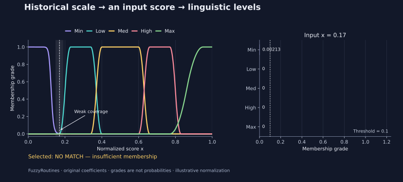

<!--
SPDX-FileCopyrightText: 2026 Timur Gilmullin and Fuzzy Technologies
SPDX-License-Identifier: Apache-2.0
-->

# Agent quick start

Give an assistant this page when you want it to install FuzzyRoutines, explain
its capabilities, calculate memberships or draw a reproducible graph. The
assistant needs a Python execution environment; a chat-only assistant can read
and explain the example, but cannot honestly report that it executed it.
No local PC, Docker, GPU, model provider or agent framework is required.

## Copyable request

> Read https://fuzzy-technologies.github.io/FuzzyRoutines/api/latest/en/agent-quickstart/ . Check Python first, install exactly FuzzyRoutines 2.1.0 from PyPI, and run the recipes from the `v2.1.0` source tag to construct the historical Universal Fuzzy Scale and classify illustrative risk scores. Return the package version, inputs, five membership grades, selected label or no match, and numerical checks. If plotting is available, produce a headless graph. Explain the weak coverage near 0.17 and why membership grades are not probabilities. If execution is unavailable, give the commands and label the results as expected.

## Version and capability map

This guide uses the [published 2.1.0 package](https://pypi.org/project/fuzzyroutines/2.1.0/)
on CPython **3.13 or 3.14**. The standalone recipe comes from the `v2.1.0`
source tag and imports no repository modules. The JSON `environment` record
identifies the installed version. The hosted `/latest/` guide can change;
see the [documentation version guide](https://fuzzy-technologies.github.io/FuzzyRoutines/api/versions/)
when reproducing an earlier release.

| Capability                | Basic scalar entry point                                        | Example                                                            |
| ---                       | ---                                                             | ---                                                                |
| Sets and memberships      | `ScalarFuzzySet`, `Triangle`, `Bell`, `Hyperbolic`, `SShoulder` | [Membership gallery](guides/membership-families.md)                |
| Linguistic classification | `LinguisticScale.Fuzzify`, `FuzzificationPolicy`                | [Historical scale](guides/universal-fuzzy-scale.md)                |
| Fuzzy logic primitives    | `TNormPolicy`, `SNormPolicy`, `NegationPolicy`, set operations  | [Operators](guides/operators.md)                                   |
| Cuts and numeric output   | `AlphaCut`, `SampleAlphaCut`, `Centroid`                        | [Alpha cuts](guides/alpha-cuts.md), [centroid](guides/centroid.md) |

**Additional 2.1 capabilities:** use the matching package for the APIs below.
The default scalar package has no external runtime dependencies.

| Capability                     | 2.1 entry point or scope                                                                                                                                         | Guide                                                                                                                                                                                                |
| ---                            | ---                                                                                                                                                              | ---                                                                                                                                                                                                  |
| Preserved historical preset    | `CreateUniversalFuzzyScale`, `UniversalFuzzyScalePolicy`, `UniversalFuzzyScaleDomains`: original terms, coefficients, exact-last tie policy and centroid windows | [Universal Fuzzy Scale](guides/universal-fuzzy-scale.md)                                                                                                                                             |
| Explicit linguistic encoding   | `LinguisticCodec`: label centroids, ordered membership vectors, scalar decoding and weighted representative averages                                             | [Encoding contracts](guides/linguistic-encoding.md)                                                                                                                                                  |
| Explainable rule inference     | `fuzzyroutines.inference`: `MamdaniModel` and zero/first-order `SugenoModel`, explicit operators, domains, failures and rule traces                              | [Rules, formulas and stage diagrams](guides/inference.md)                                                                                                                                            |
| Optional NumPy batches         | `fuzzyroutines.batches.EvaluateMembershipBatch` and `FuzzifyBatch`, selected explicitly with `backend="numpy"`; optional `numpy` extra                           | [Batch shapes and limits](guides/numpy-batches.md)                                                                                                                                                   |
| Neural inputs and outputs      | Repository CPU PyTorch example compares raw coordinates, label centroids and full membership vectors; a separate output head predicts membership grades          | [Example and ablations](guides/neural-integration.md)                                                                                                                                                |
| Differentiable Sugeno research | Repository-only zero/first-order prototype, gradient checks and held-out comparisons; **no public tensor backend in 2.1**                                        | [Experiment and decision](guides/differentiable-sugeno.md)                                                                                                                                           |
| Project homepage languages     | Website entry points, independent of the installed package                                                                                                       | [English](https://fuzzy-technologies.github.io/FuzzyRoutines/), [Русский](https://fuzzy-technologies.github.io/FuzzyRoutines/ru/), [简体中文](https://fuzzy-technologies.github.io/FuzzyRoutines/zh-CN/) |

Membership grades are not probabilities. A term centroid is a representative
coordinate, not a learned neural weight. `LinguisticCodec.AverageRepresentatives`
averages term representatives; it is not the centroid of an aggregated fuzzy
set. Mamdani can compute that aggregate centroid, whereas Sugeno averages rule
consequences using normalized firing strengths.

Torch scripts and research code are optional repository examples, not modules
or dependencies of the installed core. Pin the matching source revision when
running them. Their synthetic comparisons do not establish that fuzzy features
improve every network, and the differentiable prototype does not retune the
historical preset. The [API reference](api/index.md) and
[worked scenarios](guides/index.md) specify the contracts; use the version that
matches the installed artifact.

## Run without a checkout

In a fresh environment, run these commands in Bash. The preflight stops the
command chain before installation on unsupported Python. The recipe verifies
the exact installed package version before calculating grades.

```bash
python -c "import platform, sys; sys.exit(0 if platform.python_implementation() == 'CPython' and sys.version_info[:2] in ((3, 13), (3, 14)) else 'Use CPython 3.13 or 3.14.')" &&
python -m pip install fuzzyroutines==2.1.0 &&
curl -fLo agent_recipe.py https://raw.githubusercontent.com/Fuzzy-Technologies/FuzzyRoutines/v2.1.0/examples/agent_recipe.py &&
python -I agent_recipe.py --expect-version 2.1.0 --output scale.json > scale.stdout.json &&
python -I agent_recipe.py --expect-version 2.1.0 --scenario risk --output risk.json > risk.stdout.json &&
python -I agent_recipe.py --expect-version 2.1.0 --scenario risk --value 17 --output weak.json > weak.stdout.json
```

The first run evaluates `x=0.2`: **Low ≈ 0.5**, with the original small positive
Min tail; the selected label is **Low**. The risk example declares an illustrative
0–100 score and divides it by 100: **75 → 0.75 → High = 1**. At **17 → 0.17**,
the largest membership is only about **0.00212959**, so the risk threshold `0.1`
produces **no match**, not a confident Min decision.

Each command writes valid JSON to stdout and, with `--output`, the same JSON to
a file. The evidence contains package/Python versions, input normalization,
original coefficients, centroid-window provenance, selection policy and checks
against independent piecewise formulas with absolute tolerance `1e-12` and zero
relative tolerance. Failure returns exit code 2 and diagnostics on stderr;
`--help` works before installing the package. These finite reference checks are
regression evidence, not proof for every real input.

The risk score is supplied by the caller; the library does not infer incident
probabilities or choose a response. Define and validate your own normalization.
Values outside the declared range are rejected, never silently clamped. Grades
need not sum to one. The policy selects the **last exact maximum**; floating-point
near ties are not exact ties. A maximum **equal to** the threshold is also no match.

## Draw and inspect the result

Plotting is optional and has a separate pinned dependency file. It uses a
headless renderer; replace `risk.svg` with `risk.png` for PNG. The graph combines
the five historical curves with a membership bar chart and the selected result.
The JSON adds the figure hash and Matplotlib version. Repeated runs with the same
pinned toolchain and inputs produce identical image bytes.

```bash
curl -fLo requirements-plots.txt https://raw.githubusercontent.com/Fuzzy-Technologies/FuzzyRoutines/v2.1.0/docs/requirements-plots.txt &&
python -m pip install -r requirements-plots.txt &&
python -I agent_recipe.py --expect-version 2.1.0 --scenario risk --value 17 --plot risk.svg > plot.stdout.json
```

[](assets/figures/agent-risk.svg)
