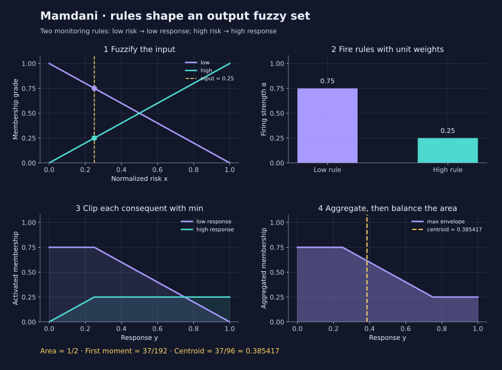
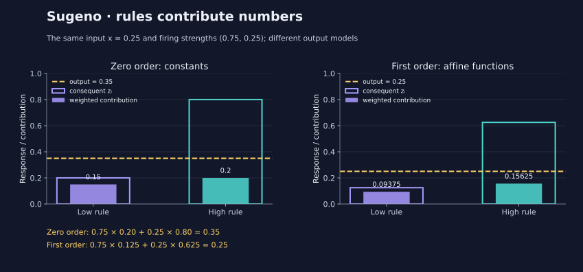

<!--
SPDX-FileCopyrightText: 2026 Timur Gilmullin and Fuzzy Technologies
SPDX-License-Identifier: Apache-2.0
-->

# From fuzzy rules to a response

Suppose a monitor reports normalized risk $x=0.25$. We want a response intensity
between zero and one. Two rules say: **if risk is low, response is low**;
**if risk is high, response is high**. Both may fire at once.

Mamdani rules contribute **fuzzy output sets**. We combine their shapes and find
the balance point of the resulting area. Sugeno rules contribute **numbers**,
possibly calculated from the inputs. We take their firing-strength-weighted
average. The input logic can be identical while the output models differ.

This illustration uses two simple ramps, $\mu_L(x)=1-x$ and $\mu_H(x)=x$, on
$[0,1]$. They give grades $(0.75,0.25)$ at $x=0.25$. These are degrees of
membership, not event probabilities. This example is not the historical
[Universal Fuzzy Scale](universal-fuzzy-scale.md) and does not retune its terms.

## Mamdani: combine shapes, then find their centroid



For this model, unit rule weights preserve the input grades. Minimum activation
clips the two output ramps at their firing strengths $0.75$ and $0.25$. Maximum aggregation
keeps the upper envelope:

$$
\alpha_i=w_i A_i(\mathbf{x}),\qquad
\mu_{\mathrm{out}}(y)=\max_i\min(\alpha_i,\mu_{B_i}(y)).
$$

The crisp response is the centroid over the explicitly chosen interval $D$:

$$
y^*=\frac{\int_D y\mu_{\mathrm{out}}(y)\,\mathrm{d}y}
{\int_D\mu_{\mathrm{out}}(y)\,\mathrm{d}y}.
$$

At $x=0.25$, the envelope is $0.75$ until $y=0.25$, then $1-y$ until
$y=0.75$, then $0.25$. Its area is $1/2$ and first moment is $37/192$;
therefore $y^*=37/96\approx0.385417$. This is a response intensity, not a
probability that an alert is correct.

```python
from fuzzyroutines import (
    ContinuousUniverse, IntegrationDomain, LinguisticTerm, NegationPolicy,
    ScalarFuzzySet, SNormPolicy, TNormPolicy,
)
from fuzzyroutines.inference import (
    FuzzyVariable, InferencePolicy, MamdaniModel, MamdaniRule, TermCondition,
)

universe = ContinuousUniverse(0, 1, True, True)
terms = (
    LinguisticTerm("low", ScalarFuzzySet(universe, lambda x: 1 - x)),
    LinguisticTerm("high", ScalarFuzzySet(universe, lambda x: x)),
)
policy = InferencePolicy(TNormPolicy("logic"), SNormPolicy("logic"), NegationPolicy("standard"))
model = MamdaniModel(
    (FuzzyVariable("risk", terms),), FuzzyVariable("response", terms),
    (
        MamdaniRule("low response", TermCondition("risk", "low"), "low"),
        MamdaniRule("high response", TermCondition("risk", "high"), "high"),
    ),
    policy, TNormPolicy("logic"), SNormPolicy("logic"),
)
result = model.Evaluate({"risk": 0.25}, IntegrationDomain(0, 1))
print(round(result.value, 6))  # 0.385417
print(tuple(rule.firingStrength for rule in result.rules))  # (0.75, 0.25)
```

Without `IntegrationDomain`, `Evaluate` returns the aggregate and activated sets
without calculating a centroid. `result.rules[i].activatedSet` and
`result.outputSet` can be sampled to explain a decision. AND, OR and NOT are
represented by `AllOf`, `AnyOf` and `NotCondition`; antecedent conjunction,
output activation and output aggregation have separate policies.

## Sugeno: combine weighted numbers



Zero-order Sugeno rules return constants, for example $(0.2,0.8)$.
First-order rules return affine functions, for example $(x/2,0.5+x/2)$:

$$
z_i=b_i+\sum_j a_{ij}x_j,\qquad
\bar\alpha_i=\frac{\alpha_i}{\sum_k\alpha_k},\qquad
z=\sum_i\bar\alpha_i z_i.
$$

For the same input and firing strengths, the constant model gives
$0.75\cdot0.2+0.25\cdot0.8=0.35$. The affine model gives
$0.75\cdot0.125+0.25\cdot0.625=0.25$. The outlined bars show each rule's
consequence; the filled bars show its weighted contribution. Their sum is the
result. There is no output-area centroid in this calculation.

Use `ConstantConsequent(value)` or
`AffineConsequent(intercept, ((inputName, coefficient), ...))` in `SugenoRule`.
`SugenoModel` requires a declared `outputUniverse`. Its trace includes
`consequentValue`, `normalizedStrength` and `contribution` for every rule.

Run the complete [monitoring example](https://github.com/Fuzzy-Technologies/FuzzyRoutines/blob/develop/examples/inference.py)
after installing the candidate version containing this API:

```bash
python examples/inference.py
```

It asserts the three independent reference values and prints JSON with inputs,
firing strengths, consequences and contributions. The example needs neither a
GUI nor plotting dependencies. The graphs can be regenerated with
`python -m tools.generate_inference_figures --output-directory docs/site/content/en/assets/figures`;
`--check` verifies their bytes against the committed versions after installing
`docs/requirements-plots.txt`.

## Compose conditions and inspect rule weights

This standalone example combines risk and load using AND, OR and NOT. With
inputs `risk=0.25` and `load=0.75`, the antecedent grades are `(0.75, 0.25)`.
The first rule's weight `0.5` changes the firing strengths to `(0.375, 0.25)`;
the normalized strengths become `(0.6, 0.4)`. The constant and affine
consequences are `(0.2, 0.625)`, so the response is `0.37`. These illustrative
rules expose the arithmetic; they are not a calibrated monitoring policy.

```python
import math

from fuzzyroutines import (
    ContinuousUniverse, LinguisticTerm, NegationPolicy,
    ScalarFuzzySet, SNormPolicy, TNormPolicy,
)
from fuzzyroutines.inference import (
    AffineConsequent, AllOf, Antecedent, AnyOf, ConstantConsequent,
    FuzzyVariable, InferencePolicy, NotCondition,
    SugenoModel, SugenoRule, TermCondition,
)

universe = ContinuousUniverse(0, 1, True, True)
terms = (
    LinguisticTerm("low", ScalarFuzzySet(universe, lambda x: 1 - x)),
    LinguisticTerm("high", ScalarFuzzySet(universe, lambda x: x)),
)
inputs = (FuzzyVariable("risk", terms), FuzzyVariable("load", terms))
policy = InferencePolicy(TNormPolicy("logic"), SNormPolicy("logic"), NegationPolicy("standard"))
busy = TermCondition("load", "high")
condition: Antecedent = AllOf((TermCondition("risk", "low"), busy))
model = SugenoModel(inputs, (
    SugenoRule("low risk and busy", condition, ConstantConsequent(0.2), weight=0.5),
    SugenoRule("risk or spare capacity", AnyOf((TermCondition("risk", "high"), NotCondition(busy))),
               AffineConsequent(0.5, (("risk", 0.5),))),
), policy, universe)
result = model.Evaluate({"risk": 0.25, "load": 0.75})
assert tuple(rule.antecedentGrade for rule in result.rules) == (0.75, 0.25)
assert tuple(rule.firingStrength for rule in result.rules) == (0.375, 0.25)
assert tuple(rule.consequentValue for rule in result.rules) == (0.2, 0.625)
assert math.isclose(result.value, 0.6 * 0.2 + 0.4 * 0.625, rel_tol=0, abs_tol=1e-15)
assert len(result.inputGrades) == 4
print(round(result.value, 2))  # 0.37
```

## Contracts that matter in an application

Each model has named scalar inputs and one scalar output. Supply exactly the
declared input names and finite in-universe coordinates. All-zero firing raises
`UndefinedResultError`; no previous result or default response is substituted.
A zero-area Mamdani output cannot be defuzzified. The composed output is
integrated numerically under `CentroidPolicy`; unresolved quadrature raises
`CentroidConvergenceError`. Sampling arbitrary callbacks cannot certify the
absence of narrow features between evaluated coordinates.

Every Sugeno consequence must be finite and belong to its output universe,
including inactive rules. Overflow raises `NumericalError`; outputs are never
silently clipped. Frozen model containers retain custom membership callables by
reference, so those callables must be pure for repeatable results.

These fixed rule models do not train parameters or preserve automatic
differentiation graphs. A trained neuro-fuzzy system is a separate model.
The [API reference](../api/modern/inference.md) documents the complete contracts.

## Sources

- Mamdani, E. H.; Assilian, S. (1975). [An experiment in linguistic synthesis with a fuzzy logic controller](https://doi.org/10.1016/S0020-7373(75)80002-2).
- Takagi, T.; Sugeno, M. (1985). [Fuzzy identification of systems and its applications to modeling and control](https://doi.org/10.1109/TSMC.1985.6313399).

The small monitoring model and worked numbers above are independently authored
teaching examples; they do not reproduce either paper's experimental plant.
