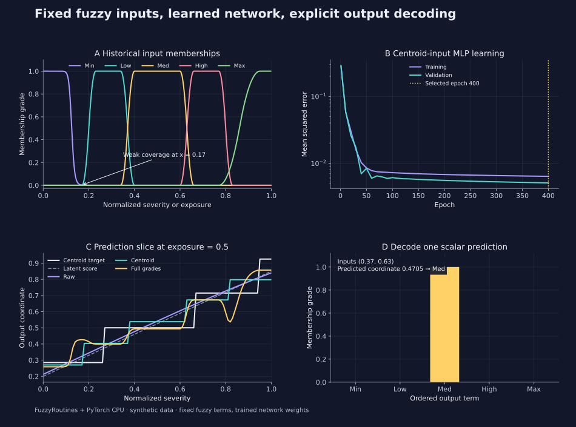
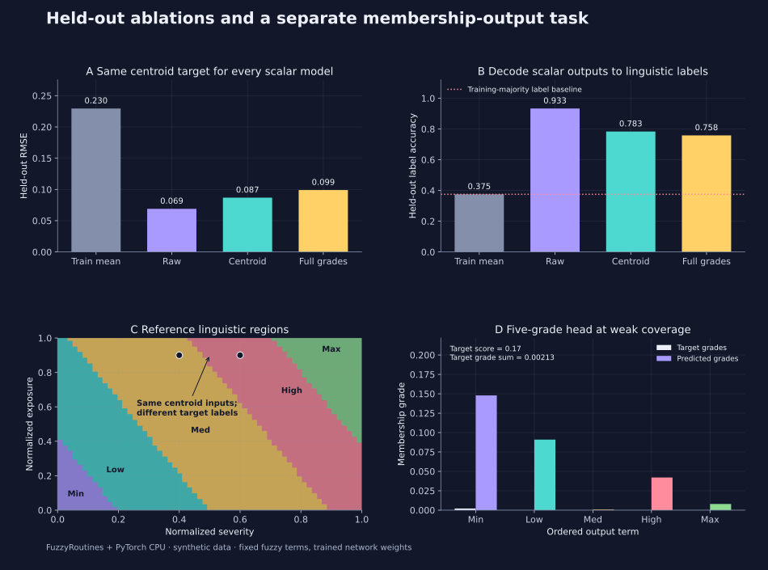

<!--
SPDX-FileCopyrightText: 2026 Timur Gilmullin and Fuzzy Technologies
SPDX-License-Identifier: Apache-2.0
-->

# Fuzzy inputs and outputs for a small neural network

This executable example combines the historical Universal Fuzzy Scale, the
explicit `LinguisticCodec`, and a small PyTorch CPU network. It starts from new
synthetic data. Fuzzy memberships and centroid windows stay fixed; training
changes only network weights. It is a neural integration example, **not a
trainable fuzzy rule system** or a validated risk model.

## Run the complete experiment

Use a checkout containing the 2.1 example. Install that candidate package into
an isolated environment; the script verifies that it imports the installed
package. The following commands target a Linux CPU environment:

```bash
python -m venv .venv-neural
. .venv-neural/bin/activate
python -m pip install .
python -m pip install --index-url https://download.pytorch.org/whl/cpu -r examples/neural/requirements.txt
python -I examples/neural/run.py --verify-installed --output neural-report.json
```

[The complete source](https://github.com/Fuzzy-Technologies/FuzzyRoutines/blob/develop/examples/neural/run.py)
generates observations, trains four networks and writes JSON to stdout and the
requested file. It needs no Docker, GPU, downloaded dataset or pretrained model.
PyTorch is an optional example dependency, pinned to 2.14.1; importing
FuzzyRoutines does not import it. The recorded run used CPython 3.14.8,
PyTorch 2.14.1+cpu, Linux x86_64, float64 and one CPU thread. A repeat took
about 21 seconds on the development host; the first cold run took 86 seconds.
These timings exclude installation and are not performance guarantees.

A smaller installation smoke uses the same code path with a reduced budget:

```bash
python -I examples/neural/run.py --verify-installed --epochs 30 --samples 90 --output neural-smoke.json
```

Consult the official [installation guide](https://pytorch.org/get-started/locally/),
[Python compatibility matrix](https://github.com/pytorch/pytorch/blob/main/RELEASE.md)
and [reproducibility notes](https://docs.pytorch.org/docs/2.14/notes/randomness.html).
Fixed seeds do not promise identical results across PyTorch versions or platforms.

## Declare the task and representations

Severity and exposure are already normalized coordinates $s,e\in[0,1]$.
There is no fitted scaler. The illustrative continuous score is

$$
y=0.05+0.65s+0.30e.
$$

Let $\mu_i$ denote the five historical memberships, in
`Min, Low, Med, High, Max` order. The selected label index and its representative
are

$$
q(x)=\max\{i:\mu_i(x)=\max_j\mu_j(x)\},\qquad
c_i=\frac{\int_{a_i}^{b_i}x\mu_i(x)\,dx}{\int_{a_i}^{b_i}\mu_i(x)\,dx}.
$$

This is the explicit last-exact-tie policy, with original windows
`(0, .23), (.17, .40), (.34, .66), (.60, .83), (.77, 1)`.
`EncodeLabel()` calculates these representatives; **they are input or target
coordinates, not learned network weights**. Unknown labels fail explicitly.
The three scalar experiments use

$$
z_{\mathrm{raw}}=(s,e),\qquad
z_{\mathrm{centroid}}=(c_{q(s)},c_{q(e)}),\qquad
z_{\mathrm{grades}}=(\mu_1(s),\ldots,\mu_5(s),\mu_1(e),\ldots,\mu_5(e)).
$$

Every scalar model predicts the **same centroid-encoded target** $t=c_{q(y)}$:

$$
\widehat t=f_\theta(z),\qquad
L_{\mathrm{scalar}}=\frac1N\sum_{n=1}^{N}(\widehat t_n-t_n)^2.
$$

`DecodePrediction()` returns the predicted coordinate's memberships, confidence
and selected label. An output outside `[0, 1]` is retained in numeric errors and
counted as a decoding failure; it is never silently clipped. Endpoints are valid.
The report includes explicit `-0.05` and `1.05` rejection examples.



## Fixed evaluation protocol

The default run draws 600 independent uniform input pairs with seed 1729.
A separate shuffle with seed 1730 fixes 360 training, 120 validation and 120
held-out identities before training. All heads use initialization seed 1731,
two 16-unit tanh layers, Adam with learning rate 0.01 and 400 full-batch epochs.
The checkpoint with minimum validation MSE is selected; held-out labels never
select checkpoints. The scalar output is linear. Input widths differ, so the
raw and centroid networks have 337 parameters and the full-grade network has 465.

The JSON records split identities, a dataset SHA-256, example-source SHA-256,
environment, learning curves, checkpoints and held-out predictions. The
[reference report](https://github.com/Fuzzy-Technologies/FuzzyRoutines/blob/develop/examples/neural/reference.json)
gives the following results for this one fixed experiment:

| Input representation    | Centroid-target RMSE | Continuous-score RMSE | Decoded label accuracy |
| --------------------    | -------------------- | --------------------- | ---------------------- |
| Training-mean target    | 0.2295               | 0.2215                | 37.5%                  |
| Raw coordinates         | 0.0690               | 0.0120                | 93.3%                  |
| Label centroids         | 0.0868               | 0.0476                | 78.3%                  |
| Full membership vectors | 0.0990               | 0.0773                | 75.8%                  |

The training-majority-label baseline also scores 37.5%. All three trained
scalar models produced zero held-out out-of-domain outputs in this run.
Continuous-score RMSE is a separate diagnostic: the training target remains
the centroid coordinate. Raw inputs perform best here. These results illustrate
integration and information loss; one synthetic split establishes no general
accuracy advantage for any representation.

## What information is lost

Inputs `(0.4, 0.9)` and `(0.6, 0.9)` both become the centroid pair for
`(Med, Max)`, but their continuous scores are 0.58 and 0.71, giving target labels
`Med` and `High`. A deterministic model receiving only that identical centroid
pair cannot distinguish them. Even the full vectors differ here by less than
$10^{-10}$, because the broad `Med` plateau hides most coordinate information
and only the tiny `Min` tail distinguishes these two values. Retaining every
grade does not guarantee a numerically useful inverse.

At coordinate 0.17, the sum of historical grades is about 0.00213, with all
terms except `Min` equal to zero. This is weak coverage, not a probability
distribution. The example preserves it instead of normalizing the vector or
replacing the historical scale. Real applications must declare their units,
normalization and acceptable coverage before encoding observations.

## A separate output-membership experiment

The fourth network consumes ten input grades and predicts five independent
bounded grades using a sigmoid output layer:

$$
g_i=\mu_i(y),\qquad \widehat g_i=\sigma(h_{\theta,i}(z_{\mathrm{grades}})),\qquad
L_{\mathrm{grades}}=\frac1{5N}\sum_{n=1}^{N}\sum_{i=1}^{5}(\widehat g_{ni}-g_{ni})^2.
$$

These targets are memberships of the **continuous score**, not memberships of
the label centroid. They are neither one-hot classes nor class probabilities;
there is no softmax or sum-to-one constraint. This 533-parameter head has a
different target and is reported separately, not ranked against scalar RMSE.
Its held-out grade RMSE is 0.1675; predicted grade sums range from 0.1315 to
1.3377. The weak-coverage probe in the figure shows a substantial mismatch.
Five bounded outputs need not be the exact membership vector of any single
coordinate. Any subsequent representative average or decision needs its own
explicit policy; it is not an inverse or a fuzzy-rule inference engine.



## Reproduce the illustrations

The figure generator reads actual report values and computes fixed reference
curves with the scalar API. It does not retrain or import PyTorch:

```bash
python -m pip install -r docs/requirements-plots.txt
python -I tools/generate_neural_figures.py --report neural-report.json --output-directory neural-figures
```

The default report is the committed reference; `--check` compares generated
SVG bytes without writing. Source hashes prevent accidentally combining a
report with a different example. Tests independently check the analytical task,
split isolation, the encoding collision, boundary failures and checkpoint
independence when held-out targets are changed. For encoding contracts and the
difference between representative averaging and a fuzzy-set centroid, see
[Linguistic encodings](linguistic-encoding.md).
