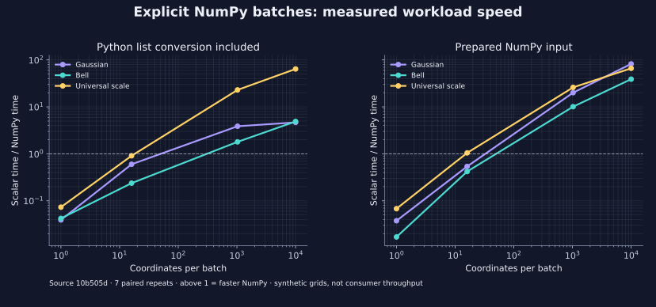

<!--
SPDX-FileCopyrightText: 2026 Timur Gilmullin and Fuzzy Technologies
SPDX-License-Identifier: Apache-2.0
-->

# Optional NumPy batches

Use batches when many coordinates share one membership function or linguistic
scale. Ordinary scalar calls remain dependency-free. The batch API was
introduced in 2.1.0. In a fresh CPython 3.13 or 3.14 environment, install the
[published 2.1.0 package](https://pypi.org/project/fuzzyroutines/2.1.0/) with its
optional NumPy extra:

```bash
python -m pip install 'fuzzyroutines[numpy]==2.1.0'
```

```python
from fuzzyroutines import CreateUniversalFuzzyScale, Triangle, UniversalFuzzyScalePolicy
from fuzzyroutines.batches import EvaluateMembershipBatch, FuzzifyBatch

grades = EvaluateMembershipBatch(Triangle(0.0, 0.5, 1.0), [0.0, 0.25, 0.5], backend="numpy")
assert grades.tolist() == [0.0, 0.5, 1.0]
result = FuzzifyBatch(CreateUniversalFuzzyScale(), [0.0, 0.3, 0.5, 0.7, 1.0], UniversalFuzzyScalePolicy(), backend="numpy")
assert result.termNames == ("Min", "Low", "Med", "High", "Max")
assert result.memberships.shape == (5, 5)
assert result.selected.argmax(axis=-1).tolist() == [0, 1, 2, 3, 4]
```

Each input has all five grades; `selected` identifies the winning term. Before
using `argmax` in general code, check `result.selected.any(axis=-1)` for no-match
rows. For `tiePolicy="all"`, inspect the complete mask instead of choosing one
index. `tied` retains all maximum terms even when `first` or `last` selects one.
The historical preset uses `UniversalFuzzyScalePolicy()` to select the last exact
maximum; the modern default still selects the first.

For input shape `(rows, columns)`, memberships and masks have shape
`(rows, columns, terms)` and confidence has shape `(rows, columns)`. The last axis
always follows `termNames`. Arrays are copied into float64; empty and sliced
arrays are accepted. Membership outputs are writable; result-record arrays are
independently owned and read-only. Use `.copy()` to edit a result.

All eight built-in families and scales assembled from them are supported.
Parameters and universe endpoints must be int/float values exactly representable
in float64. Boolean, complex, string/object and nonfinite coordinates are
rejected. Custom, normalized and composed membership callables remain scalar.
Coordinates must belong to every term universe. There is no clipping, automatic
backend selection, normalization or probability conversion.

The optional baseline is Python 3.13/3.14 and NumPy 2.3.5; the extra permits
compatible NumPy 2.x releases. See the [API](../api/modern/batches.md) for failures
and the [performance evidence at `v2.1.0`](https://github.com/Fuzzy-Technologies/FuzzyRoutines/blob/v2.1.0/docs/performance/public-batch-comparison.md)
for measured sizes and costs. Small batches may be slower; prepared arrays and
Python lists have different conversion costs. A finite parity grid does not
establish application throughput or a universal switching point.

See also the [pre-release measurements recorded at `v2.1.0`](https://github.com/Fuzzy-Technologies/FuzzyRoutines/blob/v2.1.0/docs/performance/installed-batch-results.md), which identify the exact wheel and record time, memory and NumPy import/installation costs. Small public consumer test replays are reported separately.

[](../assets/figures/numpy-batch-speed.svg)
