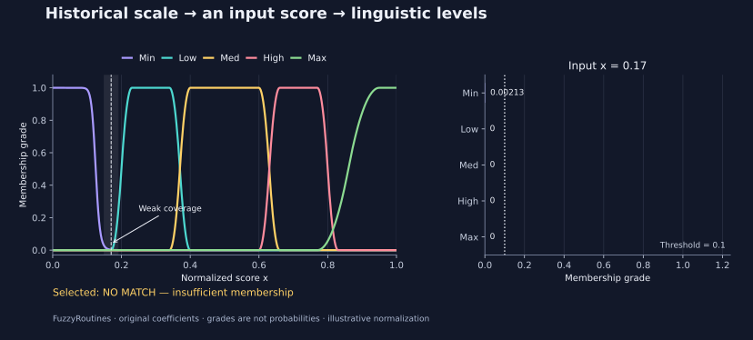

<!--
SPDX-FileCopyrightText: 2026 Timur Gilmullin and Fuzzy Technologies
SPDX-License-Identifier: Apache-2.0
-->

# Быстрый старт для ИИ-агента {#agent-quick-start}

Передайте эту страницу помощнику, чтобы он установил FuzzyRoutines, объяснил
возможности библиотеки, вычислил степени принадлежности или построил график.
Для вычислений помощнику нужна среда выполнения Python. Если он может только
переписываться, то сможет объяснить пример, но не проверить его запуском.
Локальный компьютер, Docker, GPU и специальные фреймворки для агентов не нужны.

## Запрос для помощника

> Прочитай https://fuzzy-technologies.github.io/FuzzyRoutines/api/latest/ru/agent-quickstart/ . Сначала проверь версию Python, установи именно FuzzyRoutines 2.1.0 из PyPI и запусти примеры из тега `v2.1.0`: создай историческую Универсальную нечёткую шкалу и классифицируй условные оценки риска. Покажи версию пакета, входные данные, пять степеней принадлежности, выбранный уровень или отказ от классификации и результаты численных проверок. Если доступно построение графиков, сохрани график без графического интерфейса. Объясни слабое покрытие около 0.17 и отличие степеней принадлежности от вероятностей. Если выполнить код негде, приведи команды и пометь результаты как ожидаемые.

## Версии и возможности

Руководство использует [опубликованную версию 2.1.0](https://pypi.org/project/fuzzyroutines/2.1.0/)
на CPython **3.13 или 3.14**. Автономный скрипт из тега `v2.1.0` не импортирует
модули из репозитория. Установленная версия записывается в поле `environment`
в JSON. Содержимое `/latest/` может обновляться; для воспроизведения прежних
результатов используйте [указатель версий документации](https://fuzzy-technologies.github.io/FuzzyRoutines/api/versions/).

| Возможность                 | Базовый скалярный API                                                    | Пример                                                              |
| --------------------------- | ------------------------------------------------------------------------ | ------------------------------------------------------------------- |
| Множества и принадлежность  | `ScalarFuzzySet`, `Triangle`, `Bell`, `Hyperbolic`, `SShoulder`          | [Галерея функций](guides/membership-families.md)                    |
| Лингвистические уровни      | `LinguisticScale.Fuzzify`, `FuzzificationPolicy`                         | [Историческая шкала](guides/universal-fuzzy-scale.md)               |
| Операции нечёткой логики    | `TNormPolicy`, `SNormPolicy`, `NegationPolicy`, операции над множествами | [Операторы](guides/operators.md)                                    |
| Срезы и численный результат | `AlphaCut`, `SampleAlphaCut`, `Centroid`                                 | [Альфа-срезы](guides/alpha-cuts.md), [центроид](guides/centroid.md) |

**Дополнительные возможности 2.1:** для перечисленных API нужен пакет
соответствующей версии. Скалярное ядро не требует внешних зависимостей.

| Возможность                              | Интерфейс или область применения в 2.1                                                                                                                                                       | Руководство                                                                                                                                                                                          |
| ---------------------------------------- | -------------------------------------------------------------------------------------------------------------------------------------------------------------------------------------------- | ---------------------------------------------------------------------------------------------------------------------------------------------------------------------------------------------------- |
| Готовая историческая шкала               | `CreateUniversalFuzzyScale`, `UniversalFuzzyScalePolicy`, `UniversalFuzzyScaleDomains`: исходные термы, коэффициенты, выбор последнего точного максимума и области интегрирования центроидов | [Универсальная нечёткая шкала](guides/universal-fuzzy-scale.md)                                                                                                                                      |
| Явное лингвистическое кодирование        | `LinguisticCodec`: центроиды термов, упорядоченные векторы принадлежности, декодирование числа и взвешенное среднее представителей                                                           | [Контракты кодирования](guides/linguistic-encoding.md)                                                                                                                                               |
| Объяснимый вывод по правилам             | `fuzzyroutines.inference`: `MamdaniModel` и `SugenoModel` нулевого/первого порядка, явные операторы, области, ошибки и трассировка правил                                                    | [Правила, формулы и схемы этапов](guides/inference.md)                                                                                                                                               |
| Необязательные пакетные вычисления NumPy | `fuzzyroutines.batches.EvaluateMembershipBatch` и `FuzzifyBatch`, явный выбор `backend="numpy"`; дополнительная зависимость `numpy`                                                          | [Формы массивов и ограничения](guides/numpy-batches.md)                                                                                                                                              |
| Входы и выходы нейросети                 | Пример на PyTorch для CPU в репозитории: сравнение исходных координат, центроидов термов и полных векторов принадлежности; отдельный выходной блок предсказывает степени принадлежности      | [Пример и сравнение представлений](guides/neural-integration.md)                                                                                                                                     |
| Дифференцируемая модель Сугено           | Прототип нулевого/первого порядка в репозитории, проверка градиентов и сравнение на отложенной выборке; **публичного API для тензорных вычислений в 2.1 нет**                                | [Эксперимент и решение](guides/differentiable-sugeno.md)                                                                                                                                             |
| Языки главной страницы проекта           | Страницы сайта, не зависящие от установленного пакета                                                                                                                                        | [English](https://fuzzy-technologies.github.io/FuzzyRoutines/), [Русский](https://fuzzy-technologies.github.io/FuzzyRoutines/ru/), [简体中文](https://fuzzy-technologies.github.io/FuzzyRoutines/zh-CN/) |

Степени принадлежности — не вероятности. Центроид терма — числовой представитель,
а не обучаемый вес нейросети. `LinguisticCodec.AverageRepresentatives` усредняет
представителей термов; это не центроид объединённого нечёткого множества.
В модели Мамдани можно вычислить центроид итогового множества, а модель Сугено
усредняет заключения правил с нормированными степенями активации.

Скрипты Torch и исследовательский код — необязательные примеры в репозитории;
они не входят в модули или зависимости устанавливаемого ядра. Для запуска
зафиксируйте соответствующую ревизию исходников. Сравнения на синтетических данных
не доказывают, что нечёткие признаки улучшат любую сеть; дифференцируемый прототип
не перенастраивает историческую шкалу. Точные контракты описаны в
[справочнике API](api/index.md) и [практических сценариях](guides/index.md).
Сверяйте их с версией установленного артефакта.

## Запуск без копии репозитория

В новом окружении выполните эти команды в Bash. Если версия Python не
поддерживается, первая команда остановит цепочку до установки пакета. Перед
вычислением степеней принадлежности скрипт проверит точную версию пакета.

```bash
python -c "import platform, sys; sys.exit(0 if platform.python_implementation() == 'CPython' and sys.version_info[:2] in ((3, 13), (3, 14)) else 'Use CPython 3.13 or 3.14.')" &&
python -m pip install fuzzyroutines==2.1.0 &&
curl -fLo agent_recipe.py https://raw.githubusercontent.com/Fuzzy-Technologies/FuzzyRoutines/v2.1.0/examples/agent_recipe.py &&
python -I agent_recipe.py --expect-version 2.1.0 --output scale.json > scale.stdout.json &&
python -I agent_recipe.py --expect-version 2.1.0 --scenario risk --output risk.json > risk.stdout.json &&
python -I agent_recipe.py --expect-version 2.1.0 --scenario risk --value 17 --output weak.json > weak.stdout.json
```

Первый запуск вычисляет степени принадлежности при `x=0.2`: **Low ≈ 0.5**,
при этом малый положительный хвост Min сохраняется. Выбирается уровень **Low**.
Пример риска явно задаёт условную шкалу 0–100 и делит оценку на 100:
**75 → 0.75 → High = 1**. Для **17 → 0.17** максимальная степень принадлежности
составляет лишь около **0.00212959**, поэтому порог `0.1` даёт **отсутствие
соответствия**, а не уверенное отнесение к Min.

Команда выводит JSON в stdout, а с `--output` записывает тот же JSON в файл.
В отчёте есть версии Python и пакета, нормализация, исходные коэффициенты,
исторические области интегрирования центроидов, политика выбора и проверки
по независимым кусочным формулам: абсолютный допуск `1e-12`, относительный —
ноль. При ошибке код возврата равен 2, пояснение поступает в stderr.
Справка `--help` работает до установки пакета. Проверки на конечном наборе
значений защищают от регрессий, но не доказывают свойства для всех вещественных чисел.

Оценку риска задаёт вызывающая программа: библиотека не выводит вероятность
инцидента и не выбирает ответные действия. Нормализацию нужно определить и
проверить для своей задачи. Значения за допустимым диапазоном отклоняются;
скрытого ограничения диапазоном нет. Сумма степеней принадлежности не обязана
равняться единице. При равных максимумах выбирается **последний точный максимум**;
близкие числа с плавающей точкой не считаются равными. Максимум, **равный** порогу,
тоже означает отсутствие соответствия.

## График и интерпретация

Для необязательного построения графиков есть отдельный файл с закреплёнными
версиями зависимостей. Графический интерфейс не нужен; для PNG замените
`risk.svg` на `risk.png`. Рядом с пятью историческими кривыми показаны степени
принадлежности выбранного значения и результат классификации. В JSON добавляются
хеш рисунка и версия Matplotlib. При одинаковых входах и закреплённых версиях
инструментов повторный запуск создаёт побайтово одинаковое изображение.

```bash
curl -fLo requirements-plots.txt https://raw.githubusercontent.com/Fuzzy-Technologies/FuzzyRoutines/v2.1.0/docs/requirements-plots.txt &&
python -m pip install -r requirements-plots.txt &&
python -I agent_recipe.py --expect-version 2.1.0 --scenario risk --value 17 --plot risk.svg > plot.stdout.json
```

[](../en/assets/figures/agent-risk.svg)
