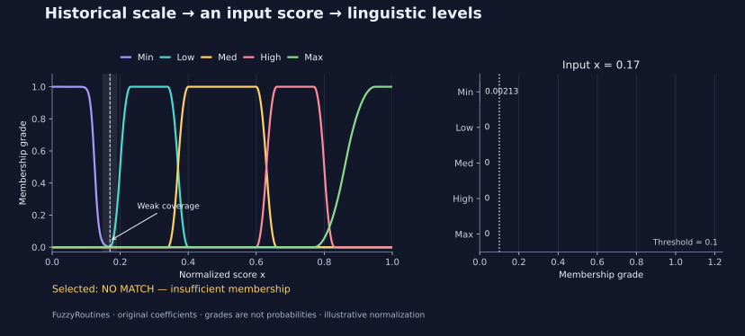

<!--
SPDX-FileCopyrightText: 2026 Timur Gilmullin and Fuzzy Technologies
SPDX-License-Identifier: Apache-2.0
-->

# Быстрый старт для ИИ-агента {#agent-quick-start}

Передайте эту страницу помощнику, чтобы он установил FuzzyRoutines, объяснил
возможности библиотеки, вычислил степени принадлежности или построил график.
Для вычислений помощнику нужна среда выполнения Python. Если он может только
переписываться, то сможет объяснить пример, но не проверить его запуском.
Локальный компьютер, Docker, GPU и специальные фреймворки для агентов не нужны.

## Запрос для помощника

> Прочитай https://fuzzy-technologies.github.io/FuzzyRoutines/api/latest/ru/agent-quickstart/ . Сначала проверь версию Python, установи именно FuzzyRoutines 2.0.0, создай историческую Универсальную нечёткую шкалу через доступный современный API и выполни примеры для шкалы и условного уровня риска. Покажи версию пакета, входные данные, пять степеней принадлежности, выбранный уровень или отсутствие соответствия и результаты численных проверок. Если доступно построение графиков, сохрани график без графического интерфейса. Объясни слабое покрытие около 0.17 и отличие степеней принадлежности от вероятностей. Если выполнять код негде, сообщи об этом и приведи команды, не выдавая их за выполненные.

## Версии и возможности

Пример использует API **опубликованной версии 2.0.0** и CPython **3.13 или 3.14**.
Содержимое документации по адресу `/latest/` обновляется; точная версия пакета
и поле `environment` в JSON показывают, что было запущено. Автономный скрипт
работает с установленным wheel и не импортирует модули из репозитория.

| Возможность                   | API опубликованной версии 2.0.0                                                             | Пример                                                                      |
| ----------------------------- | ------------------------------------------------------------------------------------------- | --------------------------------------------------------------------------- |
| Множества и принадлежность    | `ScalarFuzzySet`, `Triangle`, `Bell`, `Hyperbolic`, `SShoulder`                             | [Галерея функций](guides/membership-families.md)                            |
| Лингвистические уровни        | `LinguisticScale.Fuzzify`, `FuzzificationPolicy`                                            | [Историческая шкала](guides/universal-fuzzy-scale.md)                       |
| Операции нечёткой логики      | `TNormPolicy`, `SNormPolicy`, `NegationPolicy`, операции над множествами                    | [Операторы](guides/operators.md)                                            |
| Срезы и численный результат   | `AlphaCut`, `SampleAlphaCut`, `Centroid`                                                    | [Альфа-срезы](guides/alpha-cuts.md), [центроид](guides/centroid.md)         |
| Вывод по правилам и нейросети | Запланированы для 2.1; отсутствуют в опубликованном API 2.0.0                               | [План 2.1](https://github.com/Fuzzy-Technologies/FuzzyRoutines/milestone/8) |
| Пакетные вычисления NumPy     | Запланированы для 2.1; скалярное ядро 2.0.0 не требует внешних зависимостей                 | [План 2.1](https://github.com/Fuzzy-Technologies/FuzzyRoutines/milestone/8) |

Точные контракты описаны в [справочнике API](api/index.md) и
[практических сценариях](guides/index.md). Не подставляйте имена из планов
разработки или старого пакета вместо доступного API.

## Запуск без копии репозитория

В новой среде выполните команды по порядку. Первая проверка остановит установку
на неподдерживаемом Python. Затем скрипт потребует точную версию установленного
пакета: старый `1.0.3` не будет принят за современный API.

```bash
python -c "import platform, sys; sys.exit(0 if platform.python_implementation() == 'CPython' and sys.version_info[:2] in ((3, 13), (3, 14)) else 'Use CPython 3.13 or 3.14; do not install on 3.12.')"
python -m pip install fuzzyroutines==2.0.0
curl -fLo agent_recipe.py https://fuzzy-technologies.github.io/FuzzyRoutines/recipes/agent_recipe.py
python -I agent_recipe.py --expect-version 2.0.0 --output scale.json > scale.stdout.json
python -I agent_recipe.py --expect-version 2.0.0 --scenario risk --output risk.json > risk.stdout.json
python -I agent_recipe.py --expect-version 2.0.0 --scenario risk --value 17 --output weak.json > weak.stdout.json
```

Первый запуск вычисляет степени принадлежности при `x=0.2`: **Low ≈ 0.5**,
при этом малый положительный хвост Min сохраняется. Выбирается уровень **Low**.
Пример риска явно задаёт условную шкалу 0–100 и делит оценку на 100:
**75 → 0.75 → High = 1**. Для **17 → 0.17** максимальная степень принадлежности
составляет лишь около **0.00212959**, поэтому порог `0.1` даёт **отсутствие
соответствия**, а не уверенное отнесение к Min.

Команда выводит JSON в stdout, а с `--output` записывает тот же JSON в файл.
В отчёте есть версии Python и пакета, нормализация, исходные коэффициенты,
исторические области интегрирования центроидов, политика выбора и проверки
по независимым кусочным формулам: абсолютный допуск `1e-12`, относительный —
ноль. При ошибке код возврата равен 2, пояснение поступает в stderr.
Справка `--help` работает до установки пакета. Проверки на конечном наборе
значений защищают от регрессий, но не доказывают свойства для всех вещественных чисел.

Оценку риска задаёт вызывающая программа: библиотека не выводит вероятность
инцидента и не выбирает ответные действия. Нормализацию нужно определить и
проверить для своей задачи. Значения за допустимым диапазоном отклоняются;
скрытого ограничения диапазоном нет. Сумма степеней принадлежности не обязана
равняться единице. При равных максимумах выбирается **последний точный максимум**;
близкие числа с плавающей точкой не считаются равными. Максимум, **равный** порогу,
тоже означает отсутствие соответствия.

## График и интерпретация

Для необязательного построения графиков есть отдельный файл с закреплёнными
версиями зависимостей. Графический интерфейс не нужен; для PNG замените
`risk.svg` на `risk.png`. Рядом с пятью историческими кривыми показаны степени
принадлежности выбранного значения и результат классификации. В JSON добавляются
хеш рисунка и версия Matplotlib. При одинаковых входах и закреплённых версиях
инструментов повторный запуск создаёт побайтово одинаковое изображение.

```bash
curl -fLo requirements-plots.txt https://fuzzy-technologies.github.io/FuzzyRoutines/recipes/requirements-plots.txt
python -m pip install -r requirements-plots.txt
python -I agent_recipe.py --expect-version 2.0.0 --scenario risk --value 17 --plot risk.svg > plot.stdout.json
```

[](../en/assets/figures/agent-risk.svg)

Для проверки разрабатываемой версии установите конкретный wheel и укажите его
версию в `--expect-version`, например `2.1.0.dev0`. Это явная проверка кандидата,
а не команда установки неопубликованного релиза из PyPI. Сохраняйте JSON вместе
с изображением, чтобы результат можно было воспроизвести.
