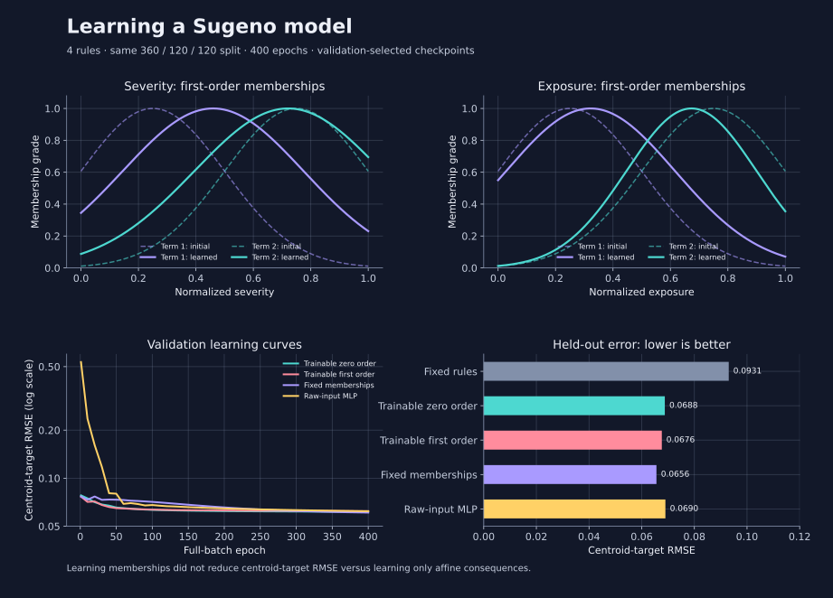
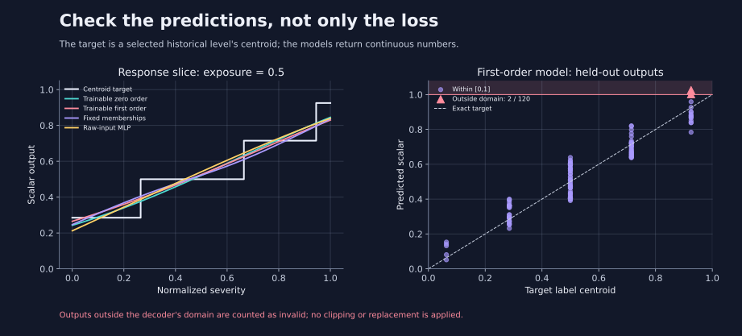

<!--
SPDX-FileCopyrightText: 2026 Timur Gilmullin and Fuzzy Technologies
SPDX-License-Identifier: Apache-2.0
-->

# Могут ли нечёткие правила обучаться

В [примере с нейросетью](neural-integration.md) нечёткое представление фиксировано:
входные термы не обучаются. Здесь проверяется другой подход — включить
функции принадлежности и [правила Сугено](inference.md) в обучаемую модель,
чтобы ошибка прогноза влияла на центры и ширину функций. Это отдельный
эксперимент в репозитории, а не публичный тензорный API.

## Небольшая дифференцируемая модель

Два нормированных входа — серьёзность и подверженность воздействию — имеют
по два гауссовых терма. Четыре сочетания термов образуют четыре правила.
Степень активации правила равна произведению двух степеней принадлежности
и фиксированного неотрицательного веса:

$$
\mu_{jk}(x_j)=\exp\!\left[-\frac{(x_j-c_{jk})^2}{2\sigma_{jk}^2}\right],\qquad
\alpha_i=w_i\prod_j\mu_{j,k(i,j)}(x_j).
$$

Здесь $j$ обозначает вход, $k$ — его терм, $i$ — правило. Центры $c$
сохраняют порядок благодаря положительным нормированным промежуткам;
ширина $\sigma$ остаётся в пределах от 0.05 до 0.8. Эти гладкие термы
не связаны с исторической универсальной нечёткой шкалой: её параметры
остаются прежними.

В модели нулевого порядка вывод каждого правила — константа, а в модели
первого порядка — аффинная функция входов:

$$
z_i=b_i+\sum_j a_{ij}x_j,\qquad
\bar\alpha_i=\frac{\alpha_i}{\sum_r\alpha_r},\qquad
\hat y=\sum_i\bar\alpha_i z_i.
$$

Для нулевого порядка все $a_{ij}=0$. Обучение минимизирует средний квадрат
ошибки, дифференцируя всё выражение целиком. Центроид выходного нечёткого
множества здесь не вычисляется. Прямой проход полностью выполняется в Torch;
скалярная `Defuz()`, преобразование в NumPy и отсоединение промежуточных тензоров
не сохраняют этот путь градиента. Переход к скалярам используется только
в отдельной проверке совпадения результатов.



## Что показал эксперимент

Используются те же 600 синтетических наблюдений и разбиение 360/120/120 на
обучающую, валидационную и тестовую части, что и в примере с нейросетью.
Простой непрерывный показатель определяет историческую метку; центроид её
терма, вычисленный современным API на исходном интервале интегрирования,
служит целевым значением регрессии. Все обучаемые модели
проходят 400 эпох Adam с шагом 0.01; на каждом шаге используется вся обучающая
выборка. Состояние модели выбирается
только по валидационной ошибке; тестовые данные не используются для настройки.

| Модель                                                          | RMSE центроидов | Точность меток | Недопустимые выходы |
| ---                                                             | ---:            | ---:           | ---:                |
| Фиксированные правила                                           | 0.093063        | 68.33%         | 0/120               |
| Обучаемая модель нулевого порядка                               | 0.068779        | 94.17%         | 0/120               |
| Обучаемая модель первого порядка                                | 0.067643        | 91.67%         | 2/120               |
| Фиксированные функции принадлежности, обучаемые аффинные выводы | 0.065600        | 88.33%         | 0/120               |
| MLP с исходными входами                                         | 0.069001        | 93.33%         | 0/120               |

Модель обучается, но обучение функций принадлежности не снизило RMSE
центроидов по сравнению с контрольным вариантом с фиксированными функциями.
При этом обучаемые модели нулевого и первого порядка точнее определяли метки:
по двум критериям лучшими оказываются разные модели.
Два прогноза модели первого порядка вышли за область декодера; они отмечены
как недопустимые без обрезки значений. Одна синтетическая задача и одна
инициализация не позволяют делать общий вывод о превосходстве подхода.



## Запуск и разбор результатов

В рабочей копии репозитория с этим экспериментом используйте Python 3.13
или новее. Установите инструменты тестирования и необязательную CPU-зависимость,
затем сохраните полные результаты в JSON:

```bash
python -m pip install -r requirements.txt
python -m pip install --index-url https://download.pytorch.org/whl/cpu -r examples/neural/requirements.txt
python -m research.run_sugeno --output /tmp/sugeno.json --measure-dependencies
python -m pytest -q tests/test_differentiable_sugeno.py tests/test_sugeno_research.py
```

[Скрипт](https://github.com/Fuzzy-Technologies/FuzzyRoutines/blob/develop/research/run_sugeno.py)
записывает начальные значения генераторов случайных чисел, индексы разбиений, хеши исходников
и данных, ошибки, прогнозы, число параметров и время работы. Зафиксированный
JSON находится в `research/results/`. В записанном запуске на одном потоке CPU
обучение каждой модели заняло примерно 2–3 секунды. Только файлы установленного
Torch заняли около 682 МиБ; основному пакету Torch не требуется.

Замороженные модели совпадают со скалярным движком Сугено с абсолютной
погрешностью не более `1e-12`; конечные разности проверяют градиенты входов,
параметров принадлежности и выводов. При нулевых весах всех правил возникает
`UndefinedResultError`. Нормирование в логарифмической области сохраняет
малые положительные веса, произведения которых могут обнулиться в скалярной
арифметике; совпадение со скалярным API заявлено для представимых произведений.

[ADR-0020](https://github.com/Fuzzy-Technologies/FuzzyRoutines/blob/develop/docs/adr/0020-differentiable-sugeno-feasibility.md)
фиксирует решение **не вводить публичную тензорную поддержку в 2.1**.
Прототип использует градиентный спуск, а не гибридный алгоритм обучения из
[статьи Джанга об ANFIS](https://doi.org/10.1109/21.256541).
Граф следует [контракту autograd в PyTorch](https://docs.pytorch.org/docs/2.14/notes/autograd.html).
