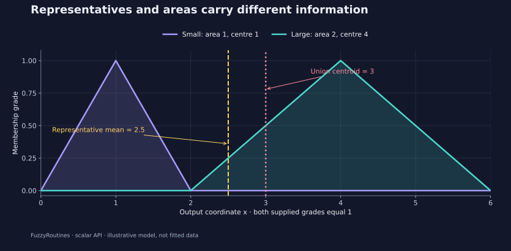

<!--
SPDX-FileCopyrightText: 2026 Timur Gilmullin and Fuzzy Technologies
SPDX-License-Identifier: Apache-2.0
-->

# Лингвистические входы и численные прогнозы {#linguistic-inputs-and-numeric-predictions}

Лингвистический уровень, вектор принадлежностей и численный представитель
содержат разную информацию. `LinguisticCodec` из API 2.1 явно задаёт эти
преобразования и не требует библиотеки нейросетей. Он обрабатывает по одному
наблюдению; преобразование кортежей в массивы или тензоры выполняет приложение.

## Кодирование наблюдений и интерпретация прогнозов {#encode-observations-and-decode-predictions}

Для терма $i$ интервал $D_i$ задаёт границы интегрирования центроида, а $\mu_i$ —
функцию принадлежности. Численный представитель и полный вектор признаков равны

$$
c_i=\frac{\int_{D_i}x\mu_i(x)\,\mathrm{d}x}{\int_{D_i}\mu_i(x)\,\mathrm{d}x},
\qquad
\mathbf{g}(x)=(\mu_1(x),\ldots,\mu_N(x)).
$$

Центроидами можно кодировать входные уровни или целевые значения обучения.
Это **не веса нейросети**: веса определяются при обучении. Численные наблюдения
и прогнозы должны быть выражены в координатах шкалы. Для исторической шкалы
это замкнутый интервал `[0, 1]`. Нормирование задаёт приложение; если его
параметры оцениваются по данным, для этого используют только обучающую выборку.

```python
from math import isclose
from fuzzyroutines import (
    CreateUniversalFuzzyScale, LinguisticCodec,
    UniversalFuzzyScaleDomains, UniversalFuzzyScalePolicy,
)

codec = LinguisticCodec(
    CreateUniversalFuzzyScale(),
    UniversalFuzzyScaleDomains(),
    UniversalFuzzyScalePolicy(),
)
assert codec.termNames == ("Min", "Low", "Med", "High", "Max")
representative = codec.EncodeLabel("Low")
assert isclose(representative, 0.285, abs_tol=1e-12)
grades = codec.EncodeMemberships(0.17)
assert 0 < sum(grades) < 0.003
prediction = codec.DecodePrediction(0.75)
assert prediction.selectedTerms[0].name == "High"
print(representative, grades, prediction.selectedTerms[0].name)
```

Получаем число около `0.285`, пять степеней принадлежности в порядке
Min/Low/Med/High/Max и уровень `High`. При `0.17` малая сумма степеней сохраняется:
это слабое покрытие, а не распределение вероятностей, которое нужно нормировать.
Результат интерпретации прогноза содержит все степени, равные максимумы и
признак отсутствия совпадения. Явная `FuzzificationPolicy` позволяет выбрать
правило разрешения равенств или ввести порог отказа от классификации.

`EncodeLabel` принимает полные имена с учётом регистра. Неизвестное имя вызывает
ошибку, а не превращается в ноль. Скалярные операции отклоняют массивы,
неконечные значения и координаты вне универсального множества любого терма.
`AverageRepresentatives` принимает один кортеж из N степеней принадлежности;
вложенные векторы и неявные пакеты наблюдений отклоняются. Кодек не обрезает
прогнозы по границам диапазона и не хранит скрытого обученного состояния.

## Среднее представителей и центроид объединённого множества {#representative-averaging-and-aggregate-centroids}

Это разные операции:

$$
y_{\mathrm{rep}}=\frac{\sum_i g_i c_i}{\sum_i g_i}
\qquad\text{and}\qquad
y_{\mathrm{set}}=\frac{\int_D x\mu_{\mathrm{aggregate}}(x)\,\mathrm{d}x}
{\int_D\mu_{\mathrm{aggregate}}(x)\,\mathrm{d}x}.
$$

Первая усредняет координаты представителей с заданными весами принадлежности.
Вторая находит центр площади явно построенного нечёткого множества. Даже при
степенях `(1, 1)` результаты могут различаться, если площади термов неодинаковы.

[](../../en/assets/figures/linguistic-encoding.svg)

```python
from math import isclose
from fuzzyroutines import (
    Centroid, ContinuousUniverse, FuzzificationPolicy, IntegrationDomain,
    LinguisticCodec, LinguisticScale, LinguisticTerm, ScalarFuzzySet,
    SNormPolicy, Triangle, Union,
)

universe = ContinuousUniverse(0, 6, leftClosed=True, rightClosed=True)
small = ScalarFuzzySet(universe, Triangle(0, 1, 2))
large = ScalarFuzzySet(universe, Triangle(2, 4, 6))
codec = LinguisticCodec(
    LinguisticScale((LinguisticTerm("Small", small), LinguisticTerm("Large", large))),
    (IntegrationDomain(0, 2), IntegrationDomain(2, 6)),
    FuzzificationPolicy(),
)
representative = codec.AverageRepresentatives((1, 1))
aggregate = Union(small, large, SNormPolicy("logic"))
aggregateCentroid = Centroid(aggregate, IntegrationDomain(0, 6))
assert representative == 2.5
assert isclose(aggregateCentroid, 3, abs_tol=1e-10)
print(representative, aggregateCentroid)
```

Площади треугольников аналитически равны 1 и 2, поэтому центроид объединения
равен $(1\cdot1+2\cdot4)/3=3$. Среднее представителей равно $(1+4)/2=2.5$.
Сумма степеней в `AverageRepresentatives` не обязана равняться единице.
Нулевой вектор вызывает `UndefinedResultError`; терм с положительной степенью
и нулевой площадью также вызывает ошибку. Терм с нулевой степенью не вносит
вклада и не требует вычисления центроида. При вызове `Centroid` для
агрегированного множества операции агрегации, область и обработка нулевой
площади должны быть определены явно.

## Почему преобразования не обратны друг другу {#why-the-conversions-are-not-inverses}

Выбор уровня отбрасывает остальные степени принадлежности. Замена уровня
центроидом сводит всю кривую к одной координате. После такого преобразования
может измениться даже выбранный уровень. Например, центроид треугольника
с вершинами `0, 1, 6` равен `7/3`. Если у другого терма в `7/3` находится
максимум, при классификации этой координаты победит другой терм. Это
закономерная потеря информации, а не ошибка восстановления.

Сохраняйте полный вектор принадлежностей, когда эти различия существенны.
Фиксированная нечёткая предобработка вокруг нейросети сама по себе не создаёт
обучаемых нечётких правил и не сохраняет градиенты автоматического дифференцирования.

## Воспроизведение графика {#reproduce-the-figure}

Установите пакет проверяемой версии и фиксированные зависимости из
`docs/requirements-plots.txt`, затем выполните:

```bash
python -m tools.generate_encoding_figure --output-directory docs/site/content/en/assets/figures
python -m tools.generate_encoding_figure --output-directory docs/site/content/en/assets/figures --check
```

Координаты кривых вычисляются публичным скалярным API. Оба итоговых значения
проверяются по независимым аналитическим формулам выше. Исходные интервалы
описаны в [руководстве по исторической шкале](universal-fuzzy-scale.md),
полные контракты кодека — в [справочнике API](../api/modern/linguistic.md).
