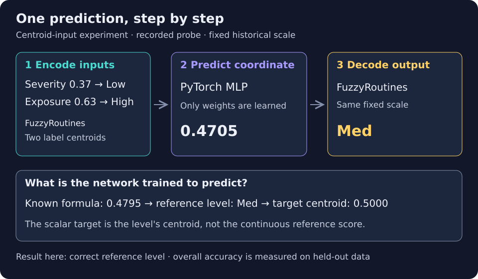

<!--
SPDX-FileCopyrightText: 2026 Timur Gilmullin and Fuzzy Technologies
SPDX-License-Identifier: Apache-2.0
-->

# Нечёткие входы и выходы небольшой нейронной сети

Этот исполняемый пример объединяет историческую универсальную нечёткую шкалу,
явный кодек `LinguisticCodec` и небольшую сеть PyTorch на CPU. Данные сгенерированы
для синтетической задачи. Функции принадлежности и интервалы расчёта
центроидов фиксированы; обучение меняет только веса сети. Это пример
интеграции с нейросетью, **а не система обучаемых нечётких правил** и не
проверенная модель оценки риска.

## Что показывает этот пример

Представим, что по двум входным показателям — серьёзности проблемы и степени
подверженности — нужно выбрать уровень от `Min` до `Max`. **Синтетическая задача**
здесь означает, что мы сами создаём искусственные пары входных значений и
вычисляем эталонную оценку по известной формуле. Так можно проверить ответ сети,
не собирая реальные данные.

FuzzyRoutines переводит координаты в названия уровней, их центроиды или векторы
степеней принадлежности. PyTorch обучает сеть получать выход по этим входам,
а FuzzyRoutines интерпретирует результат на той же шкале. Три отдельные сети
сравнивают разные представления входов: исходные координаты, центроиды уровней
и полные векторы принадлежности. Все три предсказывают центроид эталонного
выходного уровня. Четвёртая, отдельная сеть сразу предсказывает пять степеней
принадлежности непрерывной эталонной оценки. Эти степени не являются
вероятностями классов.



Разберём один случай из зафиксированного эксперимента с входами-центроидами:

| Шаг                              | Результат                                                         |
| -------------------------------- | ----------------------------------------------------------------- |
| Исходные координаты              | Серьёзность проблемы `0.37`, степень подверженности `0.63`        |
| Кодирование входов               | Уровни `Low`, `High`, преобразованные в две координаты центроидов |
| Эталонный расчёт                 | `0.05 + 0.65 × 0.37 + 0.30 × 0.63 = 0.4795` → `Med`               |
| Цель скалярной сети при обучении | Центроид `Med`: `0.5000`                                          |
| Прогноз сети и декодирование     | `0.4705` → `Med`                                                  |

В этом случае сеть восстановила эталонный уровень. Её ответ не обязан совпадать
с `0.4795`: при обучении целевым значением служит центроид уровня. Далее мы
сравним, как часто сети с разными представлениями входов восстанавливают
эталонные уровни на отложенных данных. Это не доказательство того, что нечёткие
входы повышают точность.

## Запуск полного эксперимента

Используйте рабочую копию репозитория с примером для версии 2.1. Установите
пакет из этой копии в отдельное окружение: скрипт проверит, что импортируется
именно установленный пакет. Команды рассчитаны на Linux и CPU:

```bash
python -m venv .venv-neural
. .venv-neural/bin/activate
python -m pip install .
python -m pip install --index-url https://download.pytorch.org/whl/cpu -r examples/neural/requirements.txt
python -I examples/neural/run.py --verify-installed --output neural-report.json
```

[Полный исходный код](https://github.com/Fuzzy-Technologies/FuzzyRoutines/blob/develop/examples/neural/run.py)
создаёт наблюдения, обучает четыре сети и выводит JSON в stdout и указанный
файл. Docker, GPU, внешние наборы данных и предобученные модели не нужны.
PyTorch — отдельная необязательная зависимость примера, закреплённая на версии
2.14.1; импорт FuzzyRoutines не загружает её. Зафиксированный запуск выполнен
на CPython 3.14.8, PyTorch 2.14.1+cpu, Linux x86_64, с float64 и одним потоком
CPU. Повторный запуск занял около 21 секунды на машине разработки, первый
холодный — 86 секунд. Установка в это время не входит; это измерение, а не
гарантия быстродействия.

### Что должно получиться после запуска

Команда выведет JSON-отчёт и сохранит `neural-report.json`; окно с графиком
автоматически не откроется. В `scalarAblations` секция `heldOut` каждой модели
содержит численные ошибки и `labelAccuracy` — долю отложенных наблюдений, для
которых правильно выбран выходной уровень. В `probes` записаны отдельные
прогнозы, включая разобранный выше. Секция `gradeHead` описывает отдельный
эксперимент с выходом из пяти степеней принадлежности. Сравните три скалярные
модели с эталонной таблицей ниже; при повторном запуске числа могут отличаться.
В последнем разделе показано, как построить два графика результатов по своему
отчёту. Короткая проверка ниже использует меньше данных и эпох: она проверяет
работоспособность, а не воспроизводит показатели полного эксперимента.

Для короткой проверки установки уменьшите объём данных и число эпох:

```bash
python -I examples/neural/run.py --verify-installed --epochs 30 --samples 90 --output neural-smoke.json
```

См. официальные [инструкции по установке](https://pytorch.org/get-started/locally/),
[матрицу совместимости с Python](https://github.com/pytorch/pytorch/blob/main/RELEASE.md)
и [замечания о воспроизводимости](https://docs.pytorch.org/docs/2.14/notes/randomness.html).
Фиксированные начальные состояния генераторов не гарантируют совпадения
результатов между версиями PyTorch и платформами.

## Задача и представления входов

Серьёзность проблемы (`severity`) и степень подверженности (`exposure`) уже заданы нормированными координатами
$s,e\in[0,1]$. Параметры нормирования по данным не подбираются. Условная непрерывная оценка равна

$$
y=0.05+0.65s+0.30e.
$$

Пусть $\mu_i$ — пять исторических функций принадлежности в порядке
`Min, Low, Med, High, Max`. Индекс выбранного терма и его представитель:

$$
q(x)=\max\{i:\mu_i(x)=\max_j\mu_j(x)\},\qquad
c_i=\frac{\int_{a_i}^{b_i}x\mu_i(x)\,dx}{\int_{a_i}^{b_i}\mu_i(x)\,dx}.
$$

При точном равенстве максимумов выбирается последний терм. Исходные интервалы:
`(0, .23), (.17, .40), (.34, .66), (.60, .83), (.77, 1)`.
`EncodeLabel()` вычисляет представителей; **это координаты входов или целевых
значений, а не обучаемые веса сети**. Неизвестная метка вызывает ошибку.
В трёх скалярных экспериментах используются

$$
z_{\mathrm{raw}}=(s,e),\qquad
z_{\mathrm{centroid}}=(c_{q(s)},c_{q(e)}),\qquad
z_{\mathrm{grades}}=(\mu_1(s),\ldots,\mu_5(s),\mu_1(e),\ldots,\mu_5(e)).
$$

Все скалярные модели предсказывают **одну и ту же цель, закодированную
центроидом**, $t=c_{q(y)}$:

$$
\widehat t=f_\theta(z),\qquad
L_{\mathrm{scalar}}=\frac1N\sum_{n=1}^{N}(\widehat t_n-t_n)^2.
$$

`DecodePrediction()` возвращает степени принадлежности предсказанной
координаты, максимальную степень принадлежности (`confidence`) и выбранную метку. Выход за `[0, 1]` сохраняется при
расчёте численной ошибки и считается неудачным декодированием; автоматического
ограничения диапазоном нет. Концы интервала допустимы. Отчёт содержит явные
примеры отклонённых предсказаний `-0.05` и `1.05`.


## Фиксированный протокол оценки

По умолчанию создаются 600 независимых равномерно распределённых пар входов
с начальным значением генератора 1729. Отдельная перестановка с начальным значением 1730 до обучения фиксирует 360
обучающих, 120 валидационных и 120 тестовых (отложенных) наблюдений. Все сети используют
начальное значение генератора 1731 для инициализации, два слоя по 16 нейронов с tanh, Adam с шагом 0.01
и 400 эпох с вычислением градиента по всей обучающей выборке. Выбирается состояние с минимальной
валидационной MSE; отложенные метки в выборе не участвуют. Скалярный выход
линейный. Из-за разного числа входных признаков сети для исходных координат и центроидов
имеют по 337 параметров, а сеть для полных векторов принадлежности — 465.

JSON содержит индексы разбиения, SHA-256 данных и исходного кода примера,
окружение, кривые обучения, выбранные эпохи и прогнозы на тестовых данных.
[Эталонный отчёт](https://github.com/Fuzzy-Technologies/FuzzyRoutines/blob/develop/examples/neural/reference.json)
даёт следующие результаты одного фиксированного эксперимента:

| Представление входа                        | RMSE относительно целевого центроида | RMSE относительно непрерывной оценки | Точность декодированных меток |
| ------------------------------------------ | ------------------------------------ | ------------------------------------ | ----------------------------- |
| Среднее целевое значение обучающей выборки | 0.2295                               | 0.2215                               | 37.5%                         |
| Исходные координаты                        | 0.0690                               | 0.0120                               | 93.3%                         |
| Центроиды меток                            | 0.0868                               | 0.0476                               | 78.3%                         |
| Полные векторы принадлежности              | 0.0990                               | 0.0773                               | 75.8%                         |

Постоянный прогноз наиболее частой метки обучающей выборки также даёт 37.5%. У всех трёх
обученных скалярных моделей в этом запуске прогнозы на тестовых данных остались
в области определения. RMSE относительно непрерывной оценки — отдельная
диагностика: целью обучения остаётся координата центроида. Здесь лучше всего
работают исходные входы. Результаты показывают интеграцию и потерю информации;
одно синтетическое разбиение не доказывает общего преимущества какого-либо
представления.

## Какая информация теряется

Входы `(0.4, 0.9)` и `(0.6, 0.9)` превращаются в одну и ту же пару центроидов
для `(Med, Max)`, хотя непрерывные оценки равны 0.58 и 0.71, а целевые метки —
`Med` и `High`. Детерминированная модель с одинаковой парой центроидов на входе
не сможет различить эти случаи. Даже полные векторы здесь отличаются менее
чем на $10^{-10}$: широкое плато `Med` скрывает большую часть информации о
координате, и различие остаётся лишь в малом хвосте `Min`. Сохранение всех
степеней принадлежности не гарантирует численно пригодного обратного
преобразования.

В точке 0.17 сумма исторических степеней принадлежности составляет примерно
0.00213, причём все термы, кроме `Min`, равны нулю. Это слабое покрытие,
а не распределение вероятностей. Пример сохраняет его, не нормализуя вектор
и не заменяя историческую шкалу. В прикладной задаче до кодирования наблюдений
следует определить единицы измерения, нормирование и допустимое покрытие.

## Отдельный эксперимент с выходными принадлежностями

Четвёртая сеть получает десять входных степеней принадлежности и предсказывает
пять независимых ограниченных степеней через сигмоидальный выходной слой:

$$
g_i=\mu_i(y),\qquad \widehat g_i=\sigma(h_{\theta,i}(z_{\mathrm{grades}})),\qquad
L_{\mathrm{grades}}=\frac1{5N}\sum_{n=1}^{N}\sum_{i=1}^{5}(\widehat g_{ni}-g_{ni})^2.
$$

Целевые значения — принадлежности **непрерывной оценки**, а не центроида метки.
Это степени принадлежности, а не векторы классов с единственной единицей
(one-hot) и не вероятности: softmax не используется, сумма не ограничена единицей. У этой сети 533 параметра и другая цель, поэтому её результат
приведён отдельно и не сравнивается напрямую со скалярной RMSE. RMSE степеней принадлежности
на тестовой выборке равна 0.1675; суммы предсказанных степеней лежат
в диапазоне от 0.1315 до 1.3377. Пример со слабым покрытием на рисунке показывает заметное
расхождение. Пять ограниченных выходов не обязаны совпадать с вектором
принадлежности какой-либо одной координаты. Последующее усреднение
представителей или принятие решения требует собственной явной политики;
это не обратное преобразование и не механизм вывода по нечётким правилам.


## Воспроизведение иллюстраций

Генератор использует реальные значения отчёта и вычисляет фиксированные
эталонные кривые через скалярный API. Обучение и импорт PyTorch не выполняются:

```bash
python -m pip install -r docs/requirements-plots.txt
python -I tools/generate_neural_figures.py --report neural-report.json --output-directory neural-figures
```

По умолчанию используется сохранённый эталонный отчёт; `--check` сравнивает
байты SVG без записи. Хеш исходного кода защищает от случайного совмещения
отчёта с другой версией примера. Тесты независимо проверяют аналитическую
задачу, изоляцию разбиений, совпадение разных входов после кодирования,
граничные ошибки и неизменность выбранной модели при подмене отложенных
целевых значений. Контракты кодека и отличие усреднения представителей
от центроида нечёткого множества описаны в разделе
[Лингвистическое кодирование](linguistic-encoding.md).
