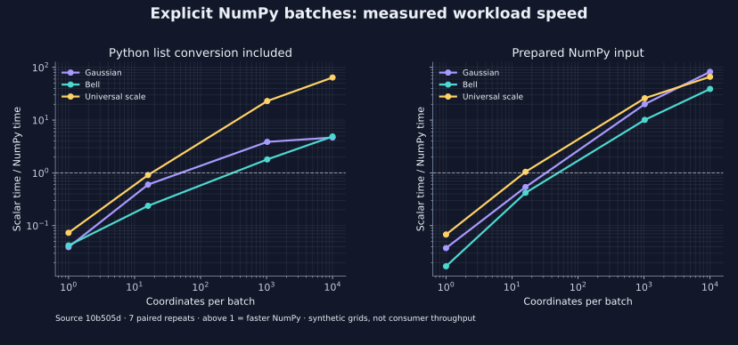

<!--
SPDX-FileCopyrightText: 2026 Timur Gilmullin and Fuzzy Technologies
SPDX-License-Identifier: Apache-2.0
-->

# Пакетные вычисления с NumPy

Пакетный API вычисляет значения функции принадлежности или степени принадлежности
к термам шкалы сразу для множества координат.
Обычные скалярные вызовы сохраняют независимость от NumPy. Установите дополнение:

```bash
python -m pip install 'fuzzyroutines[numpy]'
```

```python
from fuzzyroutines import CreateUniversalFuzzyScale, Triangle, UniversalFuzzyScalePolicy
from fuzzyroutines.batches import EvaluateMembershipBatch, FuzzifyBatch

grades = EvaluateMembershipBatch(Triangle(0.0, 0.5, 1.0), [0.0, 0.25, 0.5], backend="numpy")
assert grades.tolist() == [0.0, 0.5, 1.0]
result = FuzzifyBatch(CreateUniversalFuzzyScale(), [0.0, 0.3, 0.5, 0.7, 1.0], UniversalFuzzyScalePolicy(), backend="numpy")
assert result.termNames == ("Min", "Low", "Med", "High", "Max")
assert result.memberships.shape == (5, 5)
assert result.selected.argmax(axis=-1).tolist() == [0, 1, 2, 3, 4]
```

Для каждой координаты результат содержит все пять степеней принадлежности.
Маска `selected` указывает выбранный терм. В общем случае перед `argmax` проверяйте
`result.selected.any(axis=-1)`: если терм не выбран, вся маска состоит из `False`.
При `tiePolicy="all"` используйте всю маску. `tied` сохраняет все максимальные
термы даже при выборе одного через `first` или `last`. Исторический выбор
последнего точного максимума задаёт `UniversalFuzzyScalePolicy()`; современная
политика по умолчанию выбирает первый.

Входу формы `(rows, columns)` соответствуют степени принадлежности и маски формы
`(rows, columns, terms)`, а также максимальная степень принадлежности формы
`(rows, columns)`. Порядок
последней оси задаёт `termNames`. Вход копируется в float64; допускаются пустые
массивы и срезы. Массив результата отдельной функции принадлежности доступен для
изменения, массивы записи классификации независимы и защищены от записи.
Для изменения создайте `.copy()`.

Поддерживаются восемь встроенных семейств и шкалы из их термов. Параметры и
границы универсальных множеств должны быть числами int/float, точно
представимыми в float64. Логические, комплексные, строковые/объектные и
неконечные координаты отклоняются. Пользовательские, нормализованные и составные
функции остаются в скалярном API. Координата должна принадлежать универсальному
множеству каждого терма. Автоматического выбора вычислительного бэкенда, обрезки координат,
нормализации степеней или преобразования их в вероятности нет.

Базовая проверяемая конфигурация — Python 3.13/3.14 и NumPy 2.3.5; дополнение
допускает совместимые версии NumPy 2.x. Ошибки описаны в [API](../api/modern/batches.md),
замеры и ограничения — в [отчёте](https://github.com/Fuzzy-Technologies/FuzzyRoutines/blob/develop/docs/performance/public-batch-comparison.md).
Малые пакеты могут работать медленнее. Подготовленный массив и список Python
имеют разные затраты на преобразование; универсального порога переключения нет.

В [отчёте о замерах установленного кандидата 2.1.0](https://github.com/Fuzzy-Technologies/FuzzyRoutines/blob/develop/docs/performance/installed-batch-results.md) указаны хеш wheel, время выполнения, расход памяти и затраты на импорт и установку NumPy. Отдельно приведены результаты для небольших групп входов из публичных тестов потребителя.

[](../../en/assets/figures/numpy-batch-speed.svg)
