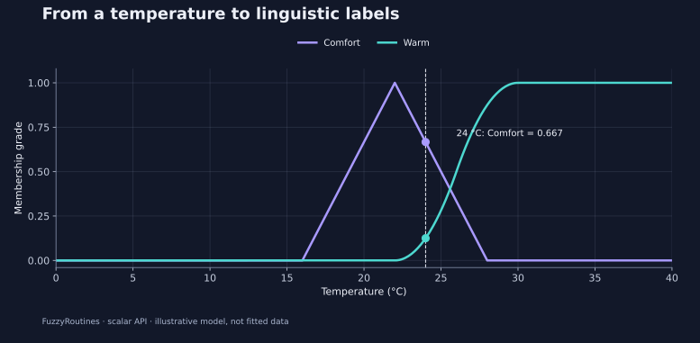

<!--
SPDX-FileCopyrightText: 2026 Timur Gilmullin and Fuzzy Technologies
SPDX-License-Identifier: Apache-2.0
-->

# Быстрый старт {#quick-start}

Преобразуем измеренную температуру в понятные степени принадлежности лингвистическим понятиям, а затем выберем метку. FuzzyRoutines предоставляет скалярные нечёткие множества, восемь семейств функций принадлежности, явные правила объединения результатов, лингвистические шкалы, альфа-срезы и центроиды непрерывных моделей. Современный API требует **CPython 3.13 или 3.14**; NumPy и библиотеки построения графиков не являются обязательными зависимостями.

## Установка {#install}

Создайте изолированное окружение:

```bash
python -m venv .venv
# Linux/macOS:
source .venv/bin/activate
# Windows PowerShell: .venv\Scripts\Activate.ps1
python -m pip install --upgrade pip
```

Установите [FuzzyRoutines 2.1.0 из PyPI](https://pypi.org/project/fuzzyroutines/2.1.0/)
и проверьте версию перед запуском примера:

```bash
python -m pip install fuzzyroutines==2.1.0
python -I -c "from importlib.metadata import version; print(version('fuzzyroutines'))"
```

Проверка должна вывести `2.1.0`. Содержимое `/latest/` может обновляться;
для конкретного релиза используйте [указатель версий документации](https://fuzzy-technologies.github.io/FuzzyRoutines/api/versions/).
[Опубликованная версия 2.0.0](https://pypi.org/project/fuzzyroutines/2.0.0/)
и её [документация в теге](https://github.com/Fuzzy-Technologies/FuzzyRoutines/blob/v2.0.0/docs/site/content/ru/quick-start.md)
остаются доступны для воспроизведения прежних результатов. Старые релизы 1.x
не содержат этого современного API.

## Измерение и классификация в несколько строк {#measure-and-classify-in-a-few-lines}

Пусть температура в комнате равна 24 °C. Зададим иллюстративное понятие *Comfort* треугольником: полная принадлежность при 22 °C, нулевая — при 16 и 28 °C. Принадлежность *Warm* плавно растёт от 22 до 30 °C. Выбирайте пороги вместе со специалистами вашей предметной области: это предположения модели, а не параметры, которые библиотека обучила по данным.

```python
from math import isclose
from fuzzyroutines import (
    ContinuousUniverse, LinguisticScale, LinguisticTerm,
    ScalarFuzzySet, SShoulder, Triangle,
)

universe = ContinuousUniverse(0, 40, leftClosed=True, rightClosed=True)
scale = LinguisticScale((
    LinguisticTerm("Comfort", ScalarFuzzySet(universe, Triangle(16, 22, 28))),
    LinguisticTerm("Warm", ScalarFuzzySet(universe, SShoulder(22, 30))),
))
result = scale.Fuzzify(24)
grades = {item.term.name: item.grade for item in result.memberships}
assert isclose(grades["Comfort"], 2 / 3)
assert grades["Warm"] == 0.125
assert result.selectedTerms[0].name == "Comfort"
print(grades, result.selectedTerms[0].name)
```


Получаем `Comfort ≈ 0.667`, `Warm = 0.125`; выбранная метка — `Comfort`. Степень принадлежности описывает соответствие заданному понятию. Это **не вероятность**, и сумма степеней не обязана равняться единице. `Fuzzify` возвращает все степени; выбор определяется явной политикой, которая по умолчанию выбирает первый терм с максимальной принадлежностью.

[](../en/assets/figures/temperature.svg)

Кривые показывают модель на объявленном универсальном множестве 0–40 °C. Пунктир отмечает измерение, точки — две вычисленные степени принадлежности. Этот пример с двумя метками намеренно не покрывает часть температур. Проверьте покрытие, прежде чем использовать его как полную рабочую шкалу.

## Объединение, исследование и объяснение результата {#combine-inspect-and-explain-a-result}

Перейдите к [девяти практическим сценариям](guides/index.md). Они показывают физические измерения, выбор правил, отказ от классификации, направленную нечёткую разность, альфа-срезы, центроиды, диагностику шкалы и пользовательские модели. Каждый содержит самостоятельный код, ожидаемые числа и график. [Галерея функций принадлежности](guides/membership-families.md) поможет выбрать кривую.

Скрипт [`examples/guide.py` из тега `v2.1.0`](https://github.com/Fuzzy-Technologies/FuzzyRoutines/blob/v2.1.0/examples/guide.py) выполняет все девять сценариев и сравнивает результаты с независимо рассчитанными эталонными значениями. Переключите локальную копию на этот тег, установите соответствующую версию пакета и выполните:

```bash
python -I examples/guide.py
python -I examples/guide.py --scenario centroid
```


Сценарий можно перенести в свой проект. Для скалярных вычислений достаточно FuzzyRoutines и стандартной библиотеки Python; просмотр сохранённых SVG не требует библиотеки построения графиков. Чтобы заново получить изображения из локальной копии репозитория, установите `docs/requirements-plots.txt` и запустите `tools/generate_guide_figures.py`, как описано в [руководстве по происхождению графиков](guides/figures.md).

Для старого кода с `MFunction`, `FuzzySet` и `FuzzyScale` начните с [исторического фасада](api/legacy/index.md). Современные множества и политики неизменяемы; исторический фасад намеренно сохраняет изменяемую модель объектов ради совместимости.
