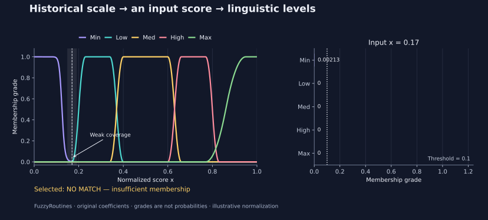

<!--
SPDX-FileCopyrightText: 2026 Timur Gilmullin and Fuzzy Technologies
SPDX-License-Identifier: Apache-2.0
-->

# AI 智能体快速入门 {#agent-quick-start}

将本页提供给助手，即可让它安装 FuzzyRoutines、了解功能、计算隶属度或绘制可复现图形。
实际计算需要可执行 Python 的环境。只能进行文本对话的助手可以解释示例，但不能声称已经执行并验证。
无需本地电脑、Docker、GPU 或专用智能体框架。

## 可直接使用的请求

> 请阅读 https://fuzzy-technologies.github.io/FuzzyRoutines/api/latest/zh-CN/agent-quickstart/ 。先检查 Python 版本，从 PyPI 安装 FuzzyRoutines 2.1.0，再运行标签 `v2.1.0` 中的示例，构造历史通用模糊标度，并对示意性风险评分进行分类。返回包版本、输入、五个隶属度、选定的语言项或无匹配结果，以及数值验证结果。如可绘图，请在无图形界面的条件下生成图形。解释 0.17 附近的覆盖为何较弱，并说明隶属度为何不同于概率。若无法执行代码，请给出命令，并将结果标为预期值。

## 版本与功能索引

本指南使用[已发布的 2.1.0 软件包](https://pypi.org/project/fuzzyroutines/2.1.0/)，
运行环境为 CPython **3.13 或 3.14**。独立脚本来自标签 `v2.1.0`，不导入仓库模块。
JSON 中的 `environment` 记录实际安装的版本。`/latest/` 文档会更新；如需复现较早的发行版，
请参见[文档版本索引](https://fuzzy-technologies.github.io/FuzzyRoutines/api/versions/)。

| 功能       | 基础标量 API 入口                                                     | 示例                                                    |
| ---      | ---                                                             | ---                                                   |
| 模糊集与隶属函数 | `ScalarFuzzySet`, `Triangle`, `Bell`, `Hyperbolic`, `SShoulder` | [隶属函数图集](guides/membership-families.md)               |
| 语言项分类    | `LinguisticScale.Fuzzify`, `FuzzificationPolicy`                | [历史通用模糊标度](guides/universal-fuzzy-scale.md)           |
| 模糊逻辑基本运算 | `TNormPolicy`, `SNormPolicy`, `NegationPolicy` 及集合运算            | [算子](guides/operators.md)                             |
| 截集与数值输出  | `AlphaCut`, `SampleAlphaCut`, `Centroid`                        | [α-截集](guides/alpha-cuts.md)、[质心](guides/centroid.md) |

**2.1 的新增功能：**下列 API 需要对应版本的软件包。默认标量核心无需外部运行时依赖。

| 功能            | 2.1 的入口或范围                                                                                                          | 指南                                                                                                                                                                                                   |
| ---           | ---                                                                                                                 | ---                                                                                                                                                                                                  |
| 保留历史参数的预设标度   | `CreateUniversalFuzzyScale`, `UniversalFuzzyScalePolicy`, `UniversalFuzzyScaleDomains`：原始语言项、系数、最后一个精确最大值选择策略及质心积分域 | [通用模糊标度](guides/universal-fuzzy-scale.md)                                                                                                                                                            |
| 显式语言项编码       | `LinguisticCodec`：语言项质心、有序隶属度向量、标量解码及代表值的加权平均                                                                       | [编码契约](guides/linguistic-encoding.md)                                                                                                                                                                |
| 可解释的规则推理      | `fuzzyroutines.inference`：`MamdaniModel` 与零阶/一阶 `SugenoModel`，显式指定算子、定义域与失败行为，并提供规则计算轨迹                             | [规则、公式与分步图示](guides/inference.md)                                                                                                                                                                    |
| 可选 NumPy 批量计算 | `fuzzyroutines.batches.EvaluateMembershipBatch` 与 `FuzzifyBatch`，通过 `backend="numpy"` 显式选择；使用可选依赖组 `numpy`          | [数组形状与适用范围](guides/numpy-batches.md)                                                                                                                                                                 |
| 神经网络输入与输出     | 仓库中的 CPU PyTorch 示例比较原始坐标、语言项质心和完整隶属度向量；另设输出头预测各项隶属度                                                                | [示例与消融比较](guides/neural-integration.md)                                                                                                                                                              |
| 可微 Sugeno 研究  | 仅在仓库中提供零阶/一阶原型、梯度检验及留出集比较；**2.1 不提供公共张量后端**                                                                         | [实验与决策](guides/differentiable-sugeno.md)                                                                                                                                                             |
| 项目主页语言        | 网站入口，与安装包相互独立                                                                                                       | [English](https://fuzzy-technologies.github.io/FuzzyRoutines/), [Русский](https://fuzzy-technologies.github.io/FuzzyRoutines/ru/), [简体中文](https://fuzzy-technologies.github.io/FuzzyRoutines/zh-CN/) |

隶属度不是概率。语言项质心是数值代表，不是神经网络的可学习权重。
`LinguisticCodec.AverageRepresentatives` 对语言项代表值求加权平均，
不等同于聚合模糊集的质心。Mamdani 模型可计算聚合结果的质心；
Sugeno 模型则以归一化规则激活强度为权重，对规则后件值求平均。

Torch 脚本和研究代码是仓库中的可选示例，不属于安装包核心的模块或依赖。
运行时应固定与已安装版本相匹配的源代码修订版本。合成数据上的比较不能证明模糊特征
必然改善所有网络；可微原型也不会重新调整历史标度的参数。
具体契约以 [API 参考](api/index.md)和[应用场景](guides/index.md)为准，
须与实际安装的构建版本对应。

## 无需检出仓库即可运行

在新建环境中用 Bash 执行以下命令。如果 Python 版本不受支持，预检会在安装前终止这组命令。
脚本会在计算隶属度前确认软件包版本完全匹配。

```bash
python -c "import platform, sys; sys.exit(0 if platform.python_implementation() == 'CPython' and sys.version_info[:2] in ((3, 13), (3, 14)) else 'Use CPython 3.13 or 3.14.')" &&
python -m pip install fuzzyroutines==2.1.0 &&
curl -fLo agent_recipe.py https://raw.githubusercontent.com/Fuzzy-Technologies/FuzzyRoutines/v2.1.0/examples/agent_recipe.py &&
python -I agent_recipe.py --expect-version 2.1.0 --output scale.json > scale.stdout.json &&
python -I agent_recipe.py --expect-version 2.1.0 --scenario risk --output risk.json > risk.stdout.json &&
python -I agent_recipe.py --expect-version 2.1.0 --scenario risk --value 17 --output weak.json > weak.stdout.json
```

第一次运行计算 `x=0.2`：**Low ≈ 0.5**，同时保留 Min 的微小正尾部，选定语言项为 **Low**。
风险示例显式采用 0–100 的示意性评分，并除以 100：**75 → 0.75 → High = 1**。
对于 **17 → 0.17**，最大隶属度仅约为 **0.00212959**；因此，阈值 `0.1` 导致**无匹配**，而不是可靠地判为 Min。

命令将有效 JSON 写入 stdout；指定 `--output` 时，同一 JSON 也写入文件。
报告包括 Python 与包版本、输入归一化、原始系数、历史质心积分域、选择策略，以及独立分段公式的数值检查。
绝对容差为 `1e-12`，相对容差为零。失败时返回退出码 2，诊断信息写入 stderr。
`--help` 在安装包之前即可运行。有限测试点提供回归验证，不能证明所有实数输入上的性质。

风险评分由调用方提供；本库不推断事件概率，也不制定处置策略。
实际应用须自行定义并验证归一化规则。超出规定范围的输入会被拒绝，不会被静默截断。
各隶属度之和不必为一。策略选择**最后一个精确最大值**；浮点数近似相等不等于精确相等。
当最大隶属度**等于**阈值时，同样判为无匹配。

## 绘图与结果解释

绘图是可选步骤，使用单独的依赖版本锁定文件。
渲染无需图形界面；将 `risk.svg` 替换为 `risk.png` 即可输出 PNG。
图中并列展示五条历史隶属函数曲线、给定输入的隶属度条形图及分类结果。
JSON 还记录图像哈希和 Matplotlib 版本。使用相同输入和锁定的工具版本，重复运行将生成字节一致的图像。

```bash
curl -fLo requirements-plots.txt https://raw.githubusercontent.com/Fuzzy-Technologies/FuzzyRoutines/v2.1.0/docs/requirements-plots.txt &&
python -m pip install -r requirements-plots.txt &&
python -I agent_recipe.py --expect-version 2.1.0 --scenario risk --value 17 --plot risk.svg > plot.stdout.json
```

[](../en/assets/figures/agent-risk.svg)
